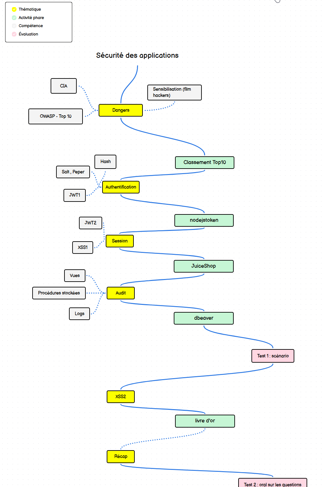
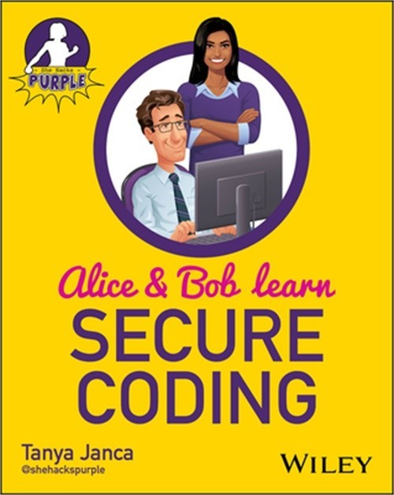

# ICT-183 Implémenter la sécurité des applications

Parcours des problématiques usuelles en sécurité applicative en suivant les guide CIA et OWASP...

## Cadre du module
- [Définition du module 183 selon ICT](legal/183.pdf)
- [Directive d'évaluation de prestations](legal/183-DEP.docx)

## Roadmap

### Évaluation
1. Test écrit sur  un scénario fictif [50%]
  - identifier / classer les risques
  - proposer des contre-mesures adaptées
  
2. Test oral sur 46 questions connues à l’avance [50%]

## Thématiques
0. [Parcours en une page : quoi, dans quel ordre, comment c'est évalué](thematiques/00-parcours.md)
1. [Risques et dangers (OWASP Top 10:2025)](thematiques/01-dangers.md)
2. [Authentification](thematiques/02-authentification.md)
3. [Session et JWT](thematiques/03-session.md)
4. [White hacker (Juice Shop)](thematiques/04-hacker.md)
5. [Audit et base de données](thematiques/05-db_audit.md)
6. [XSS](thematiques/06-xss.md)
7. [Sécurité IA](thematiques/07-ia.md)
8. [Questions orales](thematiques/08-questions.md)

## Lecture recommandée

