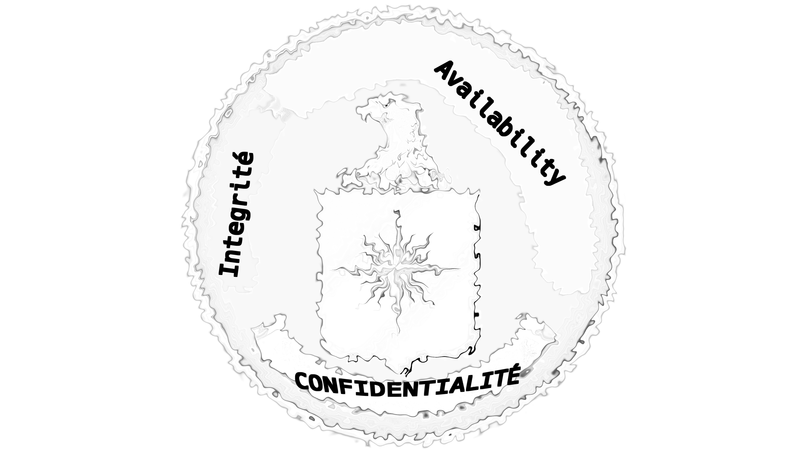
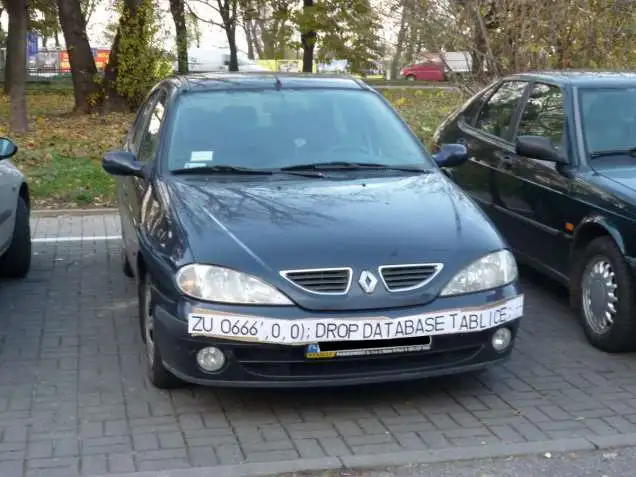

# OWASP Top 10

## Les 10 risques de sécurité les plus répandus

  

  
    ICT-183 - Thématique 01
  

---

# La triade CIA

<v-clicks>

- **Confidentialité** : accès réservé aux personnes autorisées
- **Intégrité** : données exactes et non modifiées
- **Disponibilité** : données et services accessibles quand nécessaire

</v-clicks>

<!--
Triade CIA - sécurité de l'information. Cadre fondamental de la sécurité informatique (années 1970). Objectif : protéger l'information contre l'accès non autorisé, la modification et l'indisponibilité.

1. Confidentialité : authentification, chiffrement, droits d'accès. Risque si absent : fuite de données.
2. Intégrité : hash, signatures, contrôle des changements. Risque si absent : fraude / erreurs.
3. Disponibilité : sauvegardes, redondance, anti-DDoS. Risque si absent : interruption de service.
-->

---
layout: section
---

# Partie 1
## Le Top 10 des risques de sécurité

---

# Les objectifs

À la fin de la séquence, vous serez capables de :

<v-clicks>

- **Citer** les 10 risques de sécurité les plus répandus dans l'ordre de risque (top 10)
- **Expliquer** avec vos propres mots le principe de chacun de ces risques
- **Expliquer** avec vos propres mots les contre-mesures à ces risques

</v-clicks>

<!--
Faire reformuler aux élèves la définition de chaque objectif. Le dernier objectif s'étalera sur plusieurs sessions.
-->

---

# Un moyen d'éviter les radars

<!--
Plaque d'immatriculation contenant du SQL : introduction humoristique à l'injection.
-->

---

# Activité 1 : l'impact des risques

- **Sans** moyen d'aide extérieure
- Par groupe de **3**
- Temps à disposition : **15 min**
- Mettre les post-it sur le tableau blanc

**Réflexion** sur l'application de gestion des infractions :

<v-clicks>

- les différentes **causes de risques** qui pourraient lui nuire (effet direct)
- les différents **risques** qui pourraient impacter l'entreprise et ses revenus (effet indirect)

</v-clicks>

---

# Importance de la sécurité

<v-clicks>

- Fuite de données **personnelles et sensibles**
- **Réputation**
- Conséquences **judiciaires et pénales**

</v-clicks>

### Statistiques

<v-clicks>

- **3322** compromissions de données aux USA en 2025 (ITRC)
- Une fuite de données coûte **4.44 mio USD** en moyenne (IBM 2025)
- Phishing, malware, DDoS, fuite de données
- Coût total estimé en 2025 : **10.5 trillions USD**

</v-clicks>

<!--
Sources et cartes d'attaques en direct :
- https://www.cobalt.io/blog/cybersecurity-statistics-2024
- https://www.forbes.com/advisor/education/it-and-tech/cybersecurity-statistics/
- https://em360tech.com/top-10/expensive-cyber-attacks
- https://threatmap.fortiguard.com/ , https://threatmap.bitdefender.com/ , https://livethreatmap.radware.com/ , https://cybermap.kaspersky.com/
-->

---
layout: section
---

# Partie 2
## OWASP

---

# OWASP

**Open Web Application Security Project**

<v-clicks>

- Organisation internationale à but **non lucratif**
- **Sécurité des applications Web**
- Projet le plus connu : l'**OWASP Top 10**
- Vision : « *No more insecure software* »

</v-clicks>

<!--
Ce sont les recommandations suivies par beaucoup : ce sera notre fil rouge pour ce cours. OWASP est dirigé par la communauté (des dizaines de milliers de membres).
Autres projets intéressants : https://owasp.org/projects/ - OWASP Cheat Sheet Series (https://cheatsheetseries.owasp.org/), OWASP SAMM, repo https://github.com/OWASP, YouTube https://www.youtube.com/user/OWASPGLOBAL/videos
-->

---

# Le Top 10 - version 2025

<v-clicks every=1>

1. **Broken Access Control**
2. **Security Misconfiguration**
3. **Software Supply Chain Failures**
4. **Cryptographic Failures**
5. **Injection**
6. **Insecure Design**
7. **Authentication Failures**
8. **Software and Data Integrity Failures**
9. **Security Logging and Alerting Failures**
10. **Mishandling of Exceptional Conditions**

</v-clicks>

<!--
Une courte description par risque :
1. Contrôles d'accès défaillants : des utilisateurs non autorisés effectuent des actions ou accèdent à des ressources non prévues. Risque le plus significatif du top 10.
2. Paramétrage incorrect d'un système, service ou application qui ouvre des vulnérabilités exploitables.
3. Défaillances dans la chaîne d'approvisionnement logicielle : dépendances compromises, build non sécurisé.
   Pour en discuter : https://david-gilbertson.medium.com/im-harvesting-credit-card-numbers-and-passwords-from-your-site-here-s-how-9a8cb347c5b5 , https://npm.anvaka.com/#/view/2d/express , https://www.theregister.com/2016/03/23/npm_left_pad_chaos/
4. Mauvaise utilisation ou absence de mécanismes cryptographiques, exposant des données sensibles.
5. Intégration de données non sûres dans des commandes ou requêtes (SQLi, XSS).
6. Défauts d'architecture ou de design, même si le code est correct.
7. Failles dans l'authentification ou la gestion des sessions.
8. Échec à garantir l'intégrité du code ou des données.
9. Absence de journalisation et d'alertes : détection d'attaque difficile.
10. Gestion incorrecte des erreurs, pouvant exposer des informations ou causer des interruptions.
-->

---

# Combien vous en souvenez-vous ?

Retrouver les 10 risques de mémoire

<!--
Combien vous souvenez-vous de points ? Laisser les élèves essayer avant de passer à l'activité.
-->

---

# Activité 2 : définitions

**Travail individuel** - temps à disposition : **5 min**

Document : *E-183-ALL-OWASP-Definition.docx* (imprimé)

<!--
Variante possible : version « promenade ».
-->

---
layout: center
class: text-center
---

# Questions ?

Prochaine étape : les risques 1 à 5, un par un

