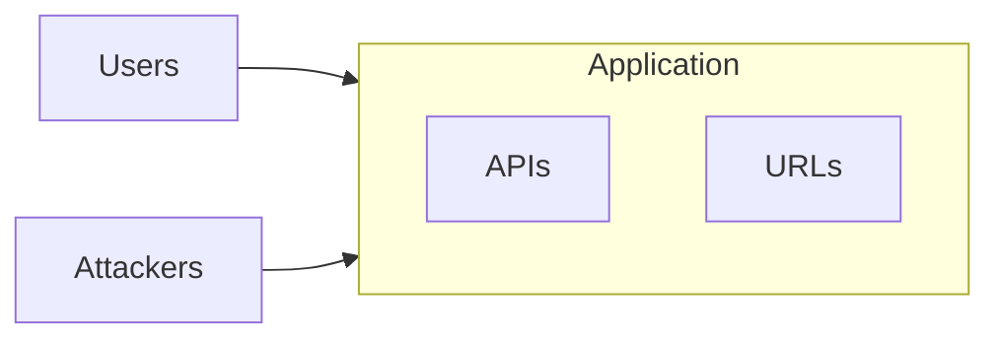
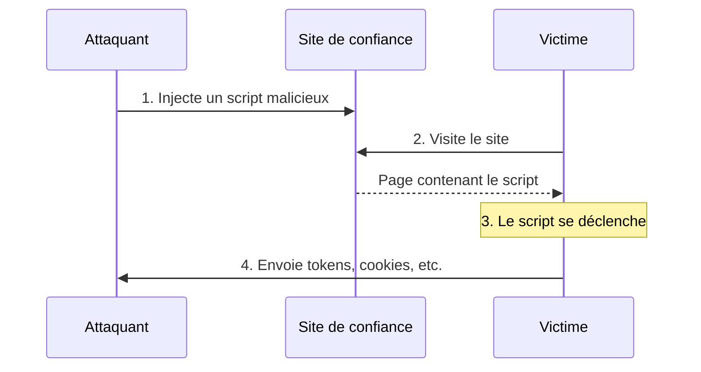

# OWASP Top 10

## Les risques 1 à 5

<div class="pt-12">
  <span class="px-2 py-1 rounded bg-blue-500 text-white">
    ICT-183 - Thématique 01
  </span>
</div>

---

# Plan de la présentation

1. **Broken Access Control**
2. **Security Misconfiguration**
3. **Software Supply Chain Failures**
4. **Cryptographic Failures**
5. **Injection** (dont SSRF)

---
layout: section
---

# 1. Broken Access Control
## Contrôle d'accès défaillant

---

# Contrôle d'accès défaillant

Un contrôle d'accès est défaillant lorsque des utilisateurs accèdent à des informations **qui ne leur sont pas destinées**.

Par exemple :

<v-clicks>

- Un document est imprimé et est visible de tous
- Un e-mail est envoyé au mauvais destinataire
- Une page personnelle de votre système est accessible à un autre utilisateur

</v-clicks>

<!--
En anglais : Broken Access Control.
-->

---

# Principe



<v-click>

<div class="mt-4 p-3 bg-blue-700 rounded text-blue-300">

**Middleware d'authentification** :

- vérifie que l'utilisateur est **authentifié**
- vérifie que l'utilisateur utilise l'application **dans la limite de ses droits**

</div>

</v-click>

---
layout: section
---

# 2. Security Misconfiguration
## Mauvaise configuration de sécurité

---

# Mauvaise configuration de sécurité

Vulnérabilité liée à :

<v-clicks>

- l'**absence de hardening**, des fonctionnalités inutiles ou inactives
- des **comptes et mots de passe par défaut**
- des **erreurs de stack** toujours affichées en production

</v-clicks>

<!--
Default setup not really secured. Analogie : faire un tour à vélo sans casque, conduire sans ceinture. Ne pas changer le mot de passe régulièrement, activer des services superflus, utiliser des mots de passe faibles.
-->

---
layout: section
---

# 3. Software Supply Chain Failures
## Défaillance dans la chaîne d'approvisionnement

---

# Défaillance dans la chaîne d'approvisionnement logicielle

**Selon OWASP** : votre application est vulnérable si vous ne connaissez pas toutes les versions de vos composants et s'ils sont vulnérables ou dépassés.

<v-clicks>

- Webapp composée de **nombreux modules et librairies** open-source ou d'une tierce partie
- Ces modules s'exécutent dans votre application : ils ont **les mêmes accès que votre code**
- Impact potentiellement **très grand**

</v-clicks>

<!--
Analogies : construire une maison avec de l'isolation contenant de l'amiante ; réaliser une poterie avec du plomb dans l'argile.
Exemples : Equifax breach 2017, SolarWinds. Typosquatting / brandjacking : paquets malveillants aux noms très proches de paquets populaires.
La sécurité de votre application est la sécurité de vos composants les plus petits.
-->

---

# Mettre à jour a un coût

<v-clicks>

- Mettre à jour des composants coûte du **temps**
- Dans les grandes entreprises, une mise à jour doit être acceptée par plusieurs personnes / équipes / départements
- **Compromis de productivité** : le temps passé à améliorer la sécurité n'est pas utilisé pour développer de nouveaux produits
- Chaque entreprise doit faire un choix en **gérant ses risques**

</v-clicks>

---

# Solution

<v-clicks>

- **Connaître** l'état de vos applications, modules externes, librairies
- **Connaître** leurs versions : vulnérables ou pas
- **Tester** proactivement votre application
- **Mettre à jour** continuellement et implémenter les patchs si nécessaire

</v-clicks>

<v-click>

<div class="mt-4 p-3 bg-blue-700 rounded text-blue-300">

C'est un problème d'**organisation / personnes / process** plus qu'un problème technique !

</div>

</v-click>

<!--
Pour faire des mises à jour, il faut l'appui des actionnaires et des dirigeants. On repousse toujours un peu plus la mise à jour jusqu'au jour où il y a le problème, et ensuite les développeurs sont pointés du doigt.
-->

---
layout: section
---

# 4. Cryptographic Failures
## Défaillances cryptographiques

---

# Défaillances cryptographiques

Vulnérabilité liée à l'**absence** ou à un **mauvais chiffrement** des données.

<v-click>

<div class="mt-4 p-3 bg-yellow-600 rounded text-yellow-200">

Où les données peuvent-elles ne pas être chiffrées correctement ?

</div>

</v-click>

<v-click>

<div class="grid grid-cols-2 gap-6 mt-4">
<div>

### Dans le stockage
- Base de données
- Disque

</div>
<div>

### Dans le transport
- HTTPS
- SSH
- VPN

</div>
</div>

</v-click>

<!--
Demander aux élèves : à quel endroit les données peuvent ne pas être chiffrées correctement (stockage / transport), quelques technologies pour chiffrer le transport (HTTPS, SSH, VPN), des exemples pour chiffrer une base de données ou un disque.
-->

---

# Questions à se poser

<v-clicks>

- Les données sensibles sont-elles **en clair** dans le stockage (ex. mot de passe en clair dans la table `users`) ?
- Les **fonctions de hachage** sont-elles sûres ? (MD5 ? SHA-1 ? SHA-256 ? SHA-512 ?)
- Y a-t-il des risques de **collision** ?
- L'**aléatoire** est-il vraiment aléatoire ?

</v-clicks>

---
layout: section
---

# 5. Injection

---

# Injection

Une vulnérabilité qui permet à un attaquant de **relayer du code malveillant** via une application vers un autre système.

Cela peut inclure la compromission des systèmes back-end ainsi que d'autres clients connectés à l'application vulnérable.

### Effets

<v-clicks>

- Exécuter des appels du **système d'exploitation** sur une machine cible
- Compromettre les **bases de données** back-end
- Compromettre ou détourner les **sessions** d'autres utilisateurs
- Forcer des actions **au nom d'autres utilisateurs** ou services

</v-clicks>

<!--
Quand une application accepte des données en entrée et les traite comme une instruction. Exemple du chien que l'on nomme « Assis » : est-ce le nom (data) ou l'instruction ?
-->

---

# Injection : Cross-Site Scripting (XSS)



<!--
Analogie du chien qui s'appelle « Sit » (assis).
-->

---

# Injection SQL

Supposons le code suivant :

```sql
SELECT * FROM t_users WHERE idUser = '«Valeur du formulaire»'
```

<v-click>

<div class="mt-4 p-3 bg-yellow-600 rounded text-yellow-200">

Quel problème peut survenir ?

</div>

</v-click>

<!--
Some of the more common injections are SQL, NoSQL, OS command, ORM, LDAP, and Expression Language (EL) or OGNL injection.
-->

---

# Injection SQL : toujours vrai

« Valeur du formulaire » pourrait être :

```text
' OR 1 = 1
```

Le code suivant serait exécuté :

```sql
SELECT * FROM t_users WHERE idUser = '' OR 1 = 1
```

<v-click>

<div class="mt-4 p-3 bg-yellow-600 rounded text-yellow-200">

Que retournerait la commande ?

</div>

</v-click>

<v-click>

<details>
<summary>Voir la solution</summary>

Toutes les lignes de `t_users` : la condition `1 = 1` est toujours vraie.

</details>

</v-click>

<!--
Noter ce bout de code au tableau (SQL Injection based on 1=1 is always true).
-->

---

# Injection SQL : destruction

« Valeur du formulaire » pourrait être :

```text
'; DROP DATABASE ...; --
```

Le code suivant serait exécuté :

```sql
SELECT * FROM t_users WHERE idUser = ''; DROP DATABASE ...; --
```

<v-click>

<div class="mt-4 p-3 bg-yellow-600 rounded text-yellow-200">

Que retournerait la commande ?

</div>

</v-click>

<v-click>

<details>
<summary>Voir la solution</summary>

La requête `SELECT` ne retourne rien d'utile, mais la commande `DROP DATABASE` est ensuite exécutée : la base de données est **supprimée**. Le `--` met en commentaire la suite de la requête d'origine.

</details>

</v-click>

---

# SSRF : falsification des requêtes serveur

*(désormais dans A01 - Broken Access Control)*

<v-clicks>

- Le SSRF permet à l'attaquant de **contraindre l'application à envoyer une requête** vers une destination inattendue
- L'attaquant peut se **faire passer pour le serveur victime** et atteindre des API internes, des bases de données
- Se produit lorsqu'un serveur veut atteindre des **ressources externes** (une image par exemple)

</v-clicks>

---

# SSRF : solutions

<v-clicks>

- Appliquer une liste **only-allowed** ou **not-allowed**
- Les webapps sont vulnérables aux attaques SSRF

</v-clicks>

<v-click>

<div class="mt-4 p-3 bg-blue-700 rounded text-blue-300">

Référence : <https://cheatsheetseries.owasp.org/cheatsheets/Server_Side_Request_Forgery_Prevention_Cheat_Sheet.html>

</div>

</v-click>

---

# Injection : se prémunir

<v-clicks>

- **Valider** les entrées de formulaire
- Appliquer le principe de **moindres privilèges**
- Éviter de passer par des services externes
- **Tester** les retours de fonctions
- **Vérifier** les exceptions

</v-clicks>

---
layout: center
class: text-center
---

# Questions ?

<div class="mt-8 text-gray-500">

Prochaine étape : les risques 6 à 10

</div>
