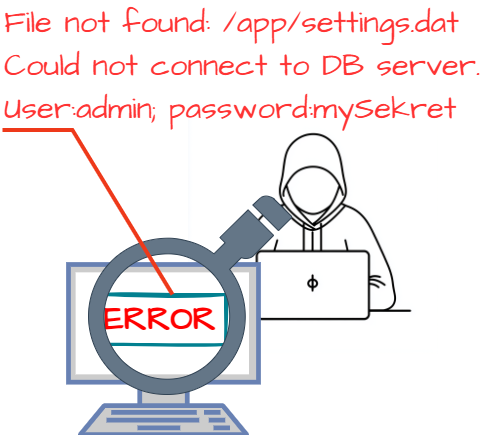

# OWASP Top 10

## Les risques 6 à 10

  
    ICT-183 - Thématique 01
  

---

# Plan de la présentation

6. **Insecure Design**
7. **Authentication Failures**
8. **Software and Data Integrity Failures**
9. **Security Logging and Alerting Failures**
10. **Mishandling of Exceptional Conditions**

Puis : **activité 2** (reconnaissance et contre-mesures), **activité 3** (attaques récentes) et conclusion.

---
layout: section
---

# 6. Insecure Design
## Conception non-sécurisée

---

# Conception non-sécurisée

Vulnérabilité liée à la **non-prise en considération des principes de sécurité** dès les premières étapes du processus de conception.

<v-click>

**Analogie** : un constructeur automobile n'a pas prévu que la ceinture de sécurité devait résister à un choc de plus de 1000 N. En cas de choc, même si l'automobiliste a parfaitement bouclé sa ceinture, la sécurité est compromise.

</v-click>

<v-click>

On distingue ici l'**implémentation** de la **conception**.

</v-click>

<!--
Aussi : données sensibles dans les logs. Analogie construction de maison : petits problèmes = lave-vaisselle cassé, ampoule ; gros problème = maison sur une pente sans fondations. Exemples : message de log donnant des infos sur un fichier de config ; mot de passe non chiffré. La sécurité compte non seulement en développement et en production, mais aussi en conception.
-->

---

# Conception non-sécurisée : shift left

Catégorie assez vaste : elle englobe les **défauts architecturaux** de l'application.

**Historiquement**

  
Planifier
→
  
Développer
→
  
Tester
→
  
Livrer
→
  
Corriger la sécurité

<v-click>

**Shift left**

  
Planifier
→
  
Prévoir la sécurité
→
  
Développer
→
  
Tester
→
  
Livrer

</v-click>

---

# Questions secrètes

Quel est le risque de sécurité avec les « questions secrètes » qui permettent de récupérer un compte ?

<v-click>

Voir la solution

Les questions et les réponses ne peuvent pas être considérées comme une preuve d'identité, car **plus d'une personne peut connaître les réponses**. Un tel code doit être supprimé et remplacé par une conception plus sécurisée.

</v-click>

<!--
Demander aux élèves : quelle pourrait être une conception plus sécurisée ?
-->

---

# Vraisemblance des réservations

Que se passerait-il si vous faisiez une application web pour une chaîne de restaurants **sans prendre en compte la vraisemblance des réservations** ?

<v-click>

Voir la solution

Les attaquants pourraient modéliser ce cas d'utilisation (*use case*) et tester s'ils peuvent réserver six cents places dans tous les restaurants à la fois en quelques requêtes, provoquant une perte massive de revenus et/ou un chaos dans les réservations. Un dégât d'image aurait aussi lieu.

</v-click>

---

# Conception non-sécurisée : se prémunir

<v-clicks>

- Implémenter la sécurité dès le début du développement (**shift left**)
- **Modéliser les menaces**
- Intégrer les contrôles de sécurité dans les **User Stories**
- **Restreindre les ressources** par service ou utilisateur
- Intégrer des contrôles de **vraisemblance**

</v-clicks>

---
layout: section
---

# 7. Authentication Failures
## Échec d'identification ou d'authentification

---

# Échec d'identification ou d'authentification

**Selon OWASP** : confirmer l'identité, ses autorisations et la gestion de sa session est un processus critique pour se protéger des attaques liées à ce domaine.

Une webapp doit confirmer **qui vous êtes** et **qui vous prétendez être**.

<v-click>

Problème : une webapp demande une identification mais **ne vérifie pas** que l'identité est correcte.

</v-click>

<!--
Imaginez une personne qui entre dans l'aéroport et prétend être pilote. Au moment de rentrer dans l'avion, est-ce que quelqu'un a demandé son identité, ses papiers ?
-->

---

# Trois problèmes typiques

<v-clicks>

**Problème 1** : identité jamais vérifiée 
*Analogie* : la personne qui prétend être pilote. 
*Exemple* : le code SMS est renvoyé mais n'est pas contrôlé par l'application.

**Problème 2** : une webapp demande un certificat au serveur mais ne vérifie pas qu'il vient bien de ce serveur 
*Conséquence* : redirection vers un site frauduleux.

**Problème 3** : une webapp ouvre une nouvelle session mais ne ferme pas correctement la précédente 
*Analogie* : la pompe à essence. *Exemple* : login sur un ordinateur public sans se déconnecter.

</v-clicks>

<!--
Problème 1 : vous faites la queue... on vous demande une pièce d'identité mais finalement on ne contrôle pas que c'est vous sur la pièce.
Problème 3 : vous faites le plein d'essence et payez, mais la session est mal fermée : la personne suivante arrive et fait le plein en payant avec votre carte.
-->

---

# Solutions

<v-clicks>

- Une webapp doit **identifier et authentifier proprement** les utilisateurs
- Semble simple mais peut être **très compliqué**

</v-clicks>

<v-click>

### Exemples complexes

- Gestion des **SSO**
- Compte Office / Eduvaud
- Compte Gmail

</v-click>

<!--
Les exemples sont là pour montrer la complexité.
-->

---
layout: section
---

# 8. Software and Data Integrity Failures
## Défaillance des logiciels et de l'intégrité des données

---

# Défaillance des logiciels et de l'intégrité des données

**Selon OWASP** :

<v-clicks>

- **CI/CD non sécurisé** : automatisation des processus sans vérification suffisante
- **Mise à jour / téléchargement** de composants automatique
- Lié au 3e point, mais différencié pour mettre en avant les risques des **cycles rapides** de développement

</v-clicks>

<!--
Agile, DevOps, CI/CD automatisent beaucoup de processus : plus productif et rapide, mais attention : attaque sur un compte développeur d'une dépendance NPM...
-->

---

# L'analogie du chocolat

<v-clicks>

- Si les ingrédients sont bons, le chocolat est bon
- Mais si les ingrédients sont mauvais ?
- Dans une webapp, **quels sont les ingrédients** ?
- Et si une mise à jour d'un logiciel externe est **buggée** ?

</v-clicks>

<v-click>

Voir la solution

Les ingrédients sont le **code**, les **plugins**, les **librairies**... Les mises à jour d'un fournisseur peuvent introduire un bug ou une faille.

</v-click>

---

# Solutions

<v-clicks>

- Être **conscient des risques** liés aux processus automatisés dans le cycle de développement
- S'assurer que ces processus sont **vérifiés et contrôlés** régulièrement

</v-clicks>

---
layout: section
---

# 9. Security Logging and Alerting Failures
## Échec des logs de sécurité et des alertes

---

# Échec des logs de sécurité et des alertes

**Selon OWASP** : sans journalisation (*logging*) et alertes (*monitoring*), les failles ne peuvent pas être détectées.

<v-clicks>

- Les problèmes de sécurité sont **inévitables**
- Mais : hacker un système prend du temps, ce n'est pas *Matrix* ou *Mr Robot* !
- Il faut un **certain nombre d'étapes**

</v-clicks>

---

# L'analogie du cambrioleur

Qu'est-ce qui aurait pu empêcher le cambriolage de continuer ?

<v-click>

Voir la solution

Le cambrioleur contrôle si les portes de la voiture sont verrouillées, entre dans une voiture ouverte, trouve une télécommande de garage et le permis avec l'adresse, ouvre le garage, trouve des clés étiquetées « maison, cave, jardin », entre dans la maison...

**Et si l'ouverture des portes était surveillée ? Le garage ? La maison ?**

</v-click>

---

# Journaliser, surveiller, alerter

Journaliser, surveiller et alerter nous permet de **stopper l'attaque**.

*UK National Cyber Security Center* : <https://www.ncsc.gov.uk/guidance/introduction-logging-security-purposes>

### Exemples de questions

<v-clicks>

- Qui a consulté ou téléchargé un fichier spécifique ?
- Y a-t-il eu des tentatives d'authentification incorrectes ?
- Qui s'est connecté récemment ?
- Des événements d'authentification se sont-ils produits à des moments ou depuis des emplacements inattendus ?

</v-clicks>

---

# Solutions

<v-clicks>

- **Log, surveillance et alertes**
- Permettent aux équipes de surveillance de **détecter** une attaque ou une brèche
- Permettent aux équipes de **stopper l'attaque** avant qu'elle ne fasse plus de dommages

</v-clicks>

---
layout: section
---

# 10. Mishandling of Exceptional Conditions
## Mauvaise gestion des conditions exceptionnelles

---

# Mishandling of Exceptional Conditions

**Selon OWASP** : une mauvaise gestion des conditions exceptionnelles se produit lorsque les programmes ne parviennent pas à **prévenir, détecter et réagir** à des situations inhabituelles et imprévisibles, ce qui entraîne des plantages, des comportements inattendus et parfois des vulnérabilités.

Source : <https://cwe.mitre.org/>

---
layout: section
---

# Activité 2
## Reconnaissance et contre-mesures

---

# Reconnaissance et contre-mesures

- Travail en **groupe de deux** sur un risque donné du top 10
- Source : <https://owasp.org/Top10/2025/>
- Prendre une **CWE** (*Common Weakness Enumeration*) liée à votre risque et compléter la présentation
- Temps à disposition : **30 min**

### À produire

<v-clicks>

- Un document synthétique basé sur le modèle [P-183-ALL-RisqueN.pptx](https://etml-inf.github.io/183-SecuriteApplication/exercices/owasp/P-183-ALL-RisqueN.pptx)
- Renommer le document (RisqueN remplacé par le nom du risque traité)
- Présentation à laisser dans Teams
- **Rendu** : présentation à la classe (5-7 min max par risque)

</v-clicks>

<!--
CWE (Common Weakness Enumeration) : liste de faiblesses matérielles ou logicielles.
-->

---
layout: section
---

# Activité 3
## Attaques informatiques récentes

---

# Attaques informatiques récentes

**Travail individuel**

<v-clicks>

- Trouver une attaque informatique récente et la noter sur un post-it
- Situer cette attaque dans le risque OWASP
- Donner la **cause** et quelques **conséquences**

</v-clicks>

<!--
Exemple : Log4j.
-->

---
layout: center
class: text-center
---

# Mot de la fin

<v-clicks>

- Reprendre les post-it de l'activité 1
- Les placer dans les catégories du top 10 OWASP
- Qu'avez-vous appris ?
- Quel sentiment avez-vous maintenant ?

</v-clicks>

  
    La sécurité se pense dès la conception
  

# Questions ?
