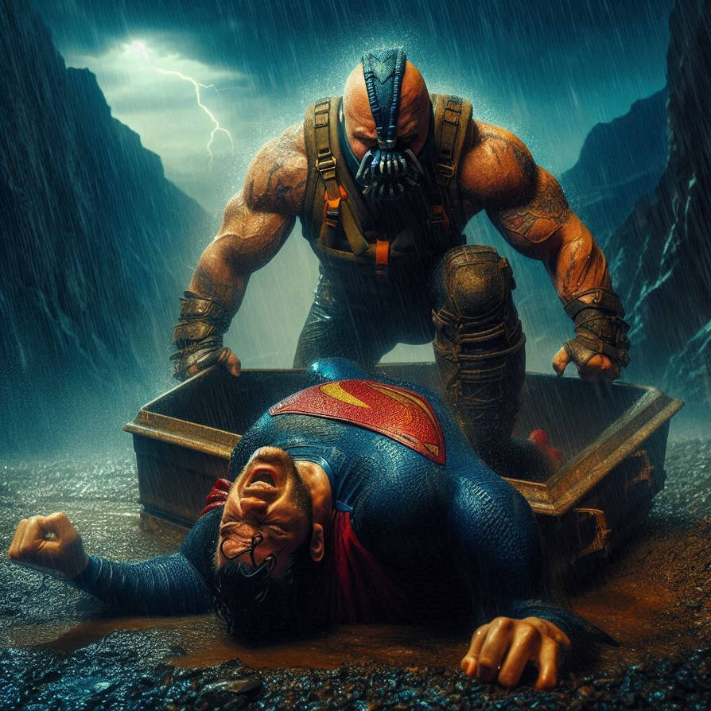
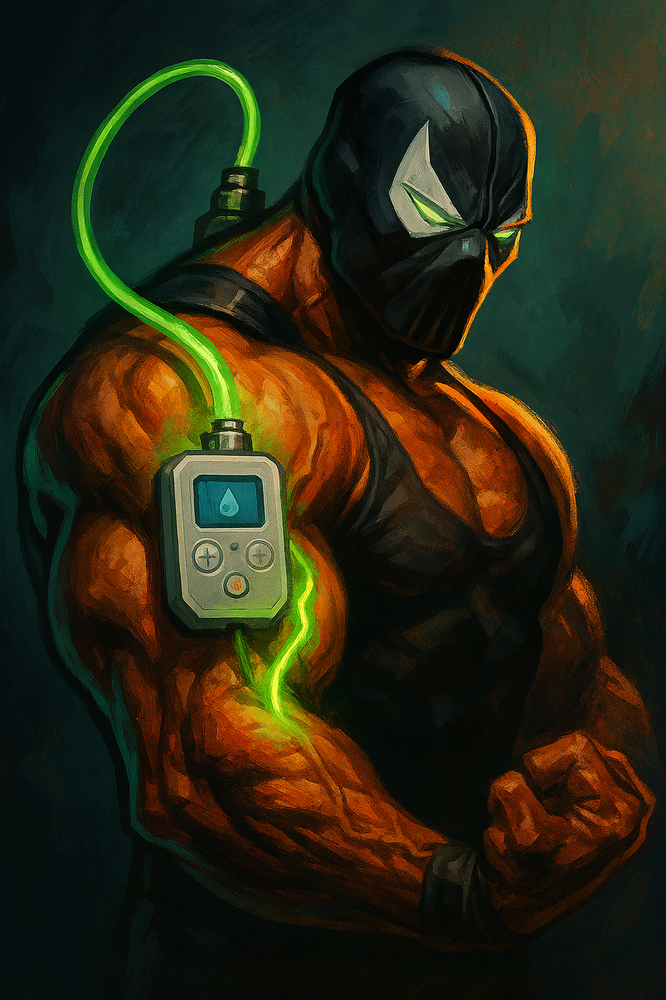
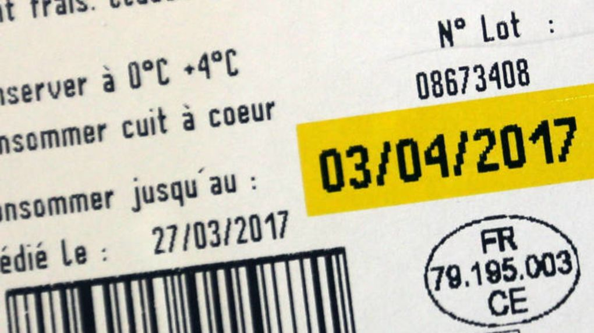
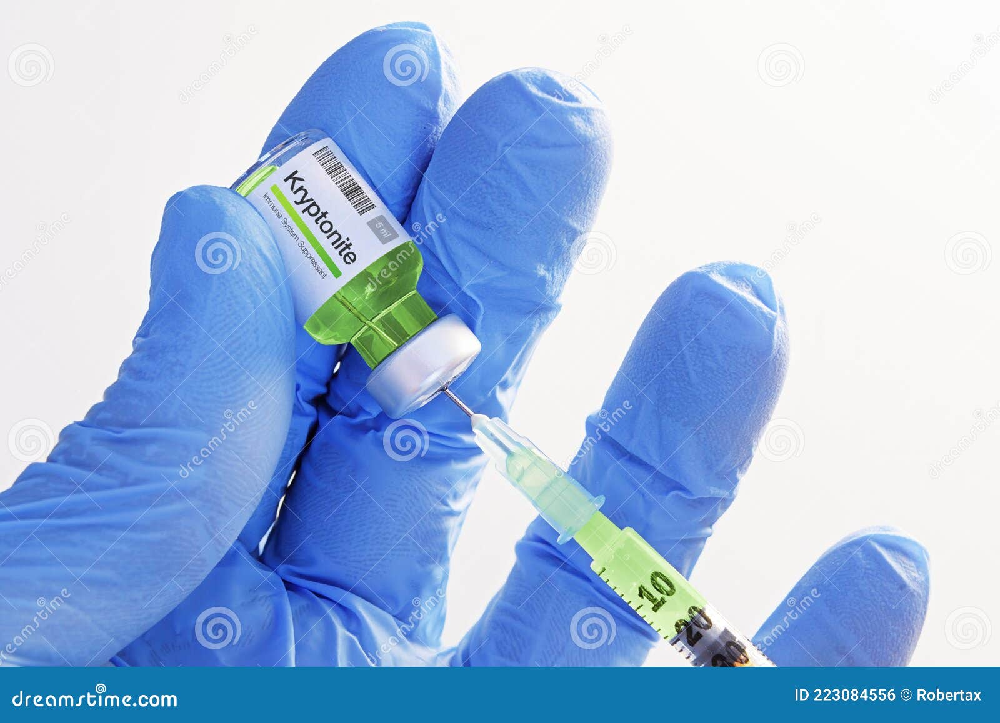
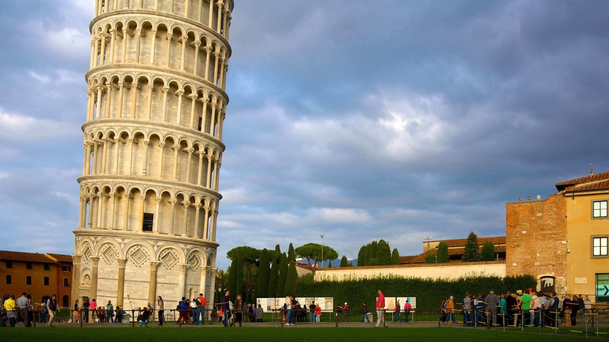
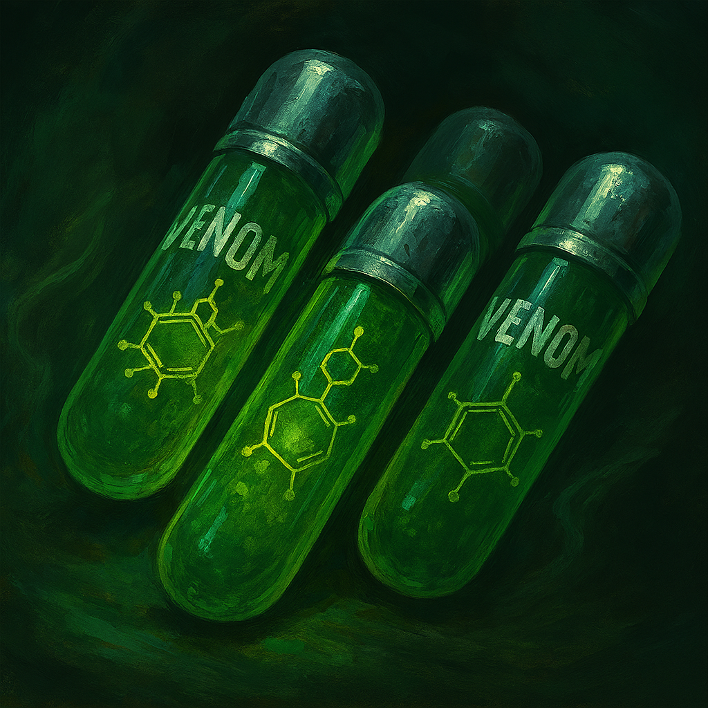
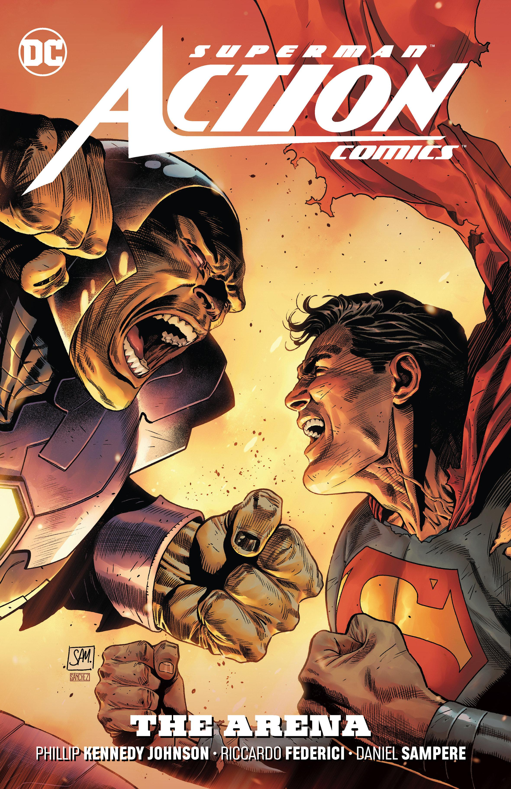

# Il était une fois...

## Superman et l'OWASP Top 10

  

<!--
Histoire à raconter ; les mots en majuscules sont les indices. Demander aux élèves de retrouver le risque OWASP correspondant à chaque slide avant d'afficher la réponse.
-->

---

# Un superman CASSÉ par Banes...

<v-click>

A01 - Broken Access Control

</v-click>

---

# La CONFIGURATION de son distributeur de venin était erronée

<v-click>

A02 - Security Misconfiguration

</v-click>

---

# Elle ne prenait pas en compte la PÉREMPTION du venin...

<v-click>

A03 - Software Supply Chain Failures (composants périmés)

</v-click>

---

# De la CRYPTOnite lui avait été INJECTée

  
  

<v-click>

A04 - Cryptographic Failures / A05 - Injection

</v-click>

---

# Pour prendre sa revanche il devait trouver un DÉFAUT à son ennemi

<v-click>

A06 - Insecure Design

</v-click>

---

# Il suffisait donc de S'INTRODUIRE dans le labo secret de son ennemi

<v-click>

A07 - Authentication Failures

</v-click>

---

# Et INTÉGRER une molécule à oxydation rapide dans les recharges...

<v-click>

A08 - Software and Data Integrity Failures

</v-click>

---

# Tout ça sans ALERTE malgré les caméras de surveillance

<v-click>

A09 - Security Logging and Alerting Failures

</v-click>

---

# ...sachant que lors d'une PANNE électrique, la porte S'OUVRAIT toute seule...

<v-click>

A10 - Mishandling of Exceptional Conditions

</v-click>

---
layout: center
class: text-center
---

# THE END

Retrouver les 10 risques dans l'ordre ?

