# Il était une fois...

## Superman et l'OWASP Top 10

  

<!--
Histoire à raconter ; les mots en majuscules sont les indices. Demander aux élèves de retrouver le risque OWASP correspondant à chaque slide avant d'afficher la réponse.

Fil rouge : Superman doit neutraliser le canon sans toucher la kryptonite (elle le rend malade). Son plan : faire débrancher la kryptonite du canon et l'envoyer dans l'espace par les robots de Lex.

Déroulé chronologique (chaque étape sert à la suivante) :
A01 il entre avec un badge livreur qui ouvre tout -> il rejoint un poste de pilotage
A02 ce poste (accessible seulement sur place) est en configuration d'usine : admin/admin -> il se connecte
A03 il lit l'inventaire des robots : fournisseur jamais vérifié, récepteur radio caché
A04 il écoute ce canal radio : ordres en clair -> il note le code 1234 (maintenance)
A05 il entre 1234 dans la console d'un robot, injecte du SQL -> couloirs ouverts, alarme coupée
A06 dans le couloir central, un plan mural lui fait comprendre qu'un seul panneau (salle maîtresse) envoie tous les ordres critiques : pas de plan B
A07 la porte de la salle maîtresse est gardée par un robot qui demande une identité : « je suis le boss » suffit
A08 au panneau, il lance une fausse mise à jour non signée -> les robots débranchent la kryptonite et l'envoient dans l'espace
A09 personne n'a rien vu (garde endormi, logs non lus, pas d'alerte) : Lex comprend en voyant la fusée
A10 Lex coupe le courant pour bloquer Superman : la panne ouvre les issues de secours, Superman s'échappe
-->

---

# Lex a bâti une forteresse « inviolable » autour de son canon à kryptonite

Superman doit le désactiver, sans jamais s'approcher de la kryptonite

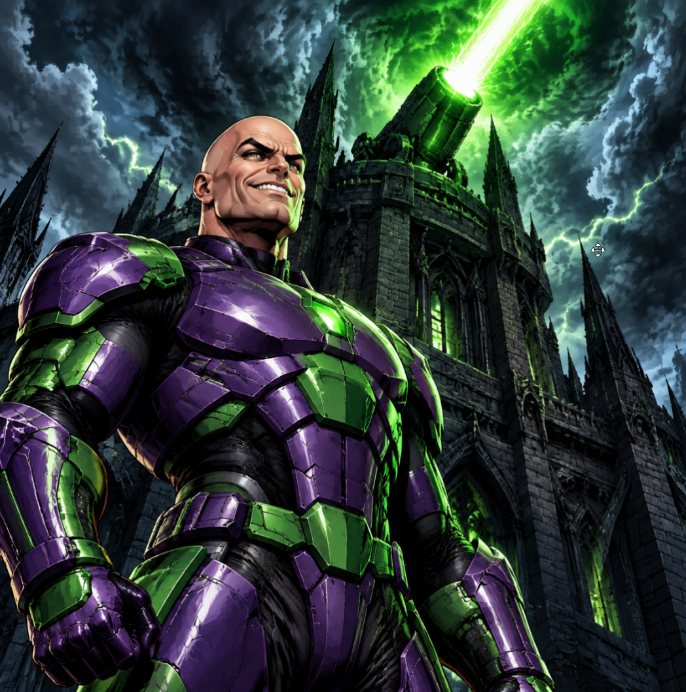

---

# Déguisé en livreur, son badge ouvre TOUTES les portes, même celle du labo VIP

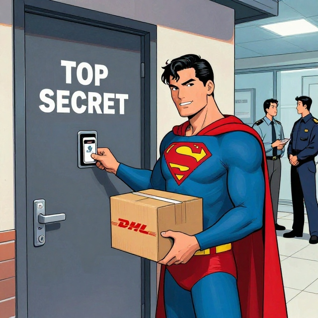

<v-click>

A01 - Broken Access Control

</v-click>

<!--
Il n'entre pas dans le labo VIP (kryptonite !) : il file vers un poste de pilotage.
-->

---

# Sur place, le poste de pilotage est resté en CONFIGURATION d'usine : il s'y connecte en admin/admin

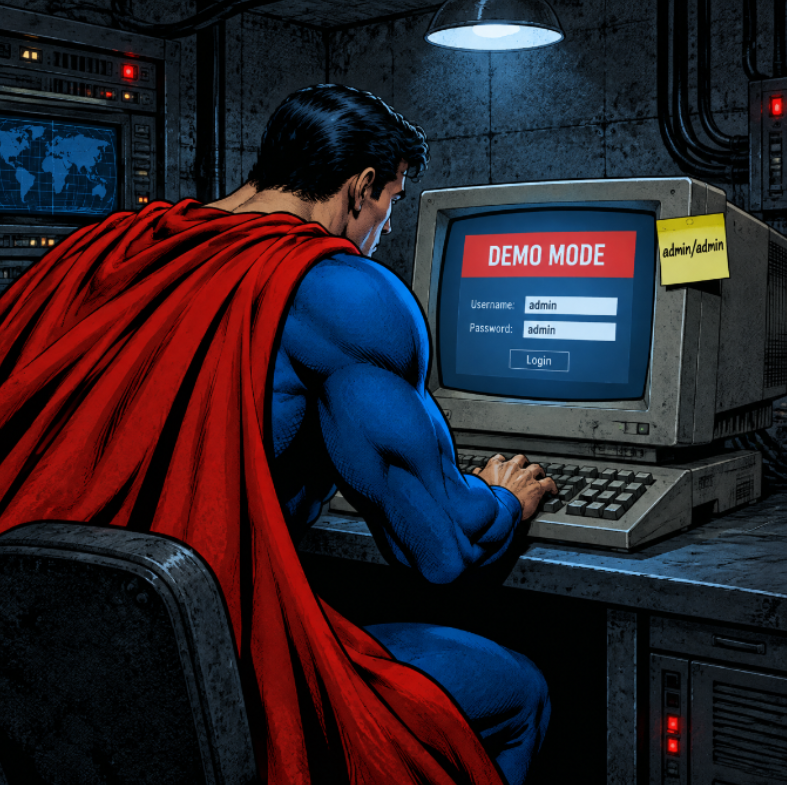

<v-click>

A02 - Security Misconfiguration

</v-click>

<!--
Ce poste n'est accessible que sur place : Superman doit donc être dans la forteresse.
-->

---

# Connecté, il lit l'inventaire des robots : un FOURNISSEUR jamais vérifié et un récepteur radio caché

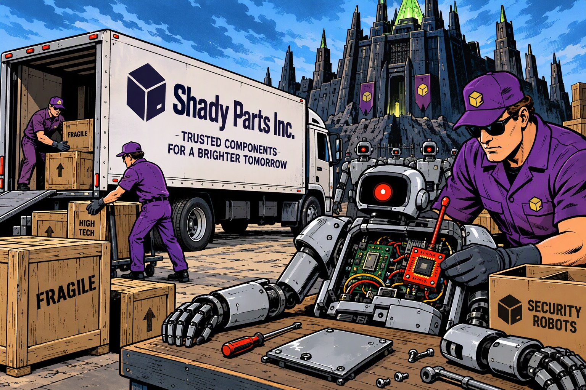

<v-click>

A03 - Software Supply Chain Failures

</v-click>

<!--
Lex a pris le fournisseur le moins cher, sans inventaire ni contrôle des composants. Problème : l'origine du composant, pas sa façon de communiquer.
-->

---

# Il écoute ce canal radio : les ordres de Lex passent EN CLAIR, sans CHIFFREMENT, avec le code 1234

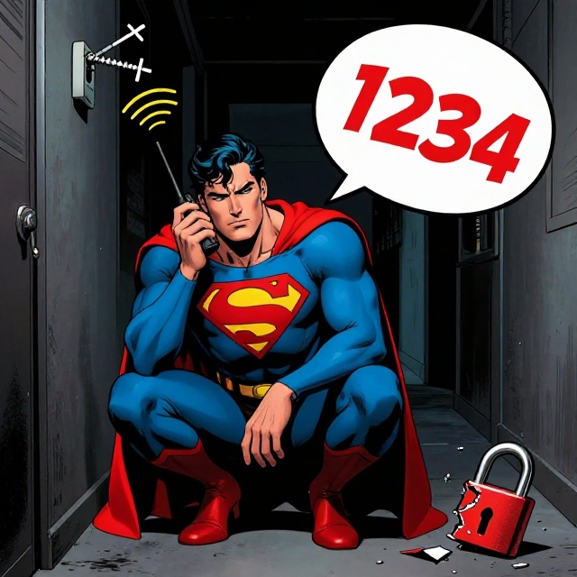

<v-click>

A04 - Cryptographic Failures

</v-click>

<!--
Un simple talkie-walkie suffit. 1234 est le code d'accès à la console de maintenance des robots. Ici c'est Lex qui est en cause (ses propres communications), pas le fournisseur.
-->

---

# Il entre 1234 dans la console d'un robot et y INJECTE du SQL : couloirs ouverts, alarme coupée

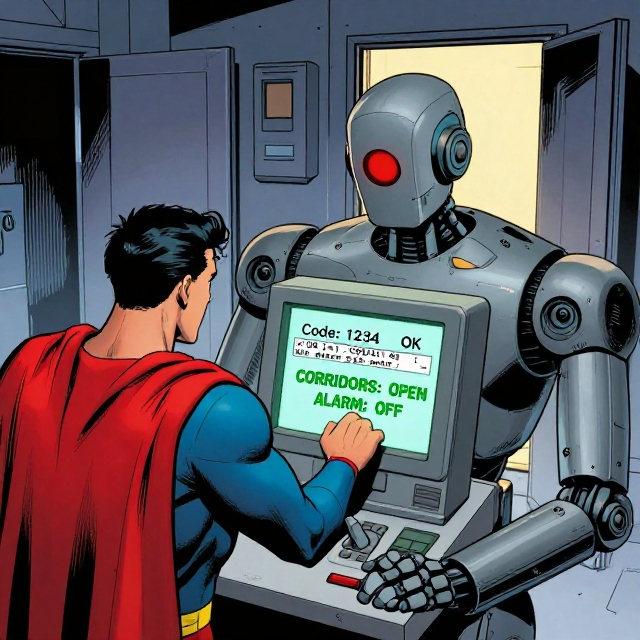

<v-click>

A05 - Injection

</v-click>

<!--
La console construit une requête avec le texte saisi : SELECT door FROM permissions WHERE visitor = '<saisie>'. Superman saisit x' OR 1=1 ; UPDATE alarm SET on=0 ; -- : toutes les portes de circulation s'ouvrent et l'alarme est coupée. La salle maîtresse n'est pas concernée (voir A07). Le code 1234 est un code de maintenance : il ne donne accès qu'aux accès et à l'alarme, pas aux ordres critiques. La faille ici est la saisie non filtrée (requête non paramétrée).
-->

---

# Un plan mural le montre : un seul panneau, dans la salle maîtresse, pilote tout. La CONCEPTION est bancale

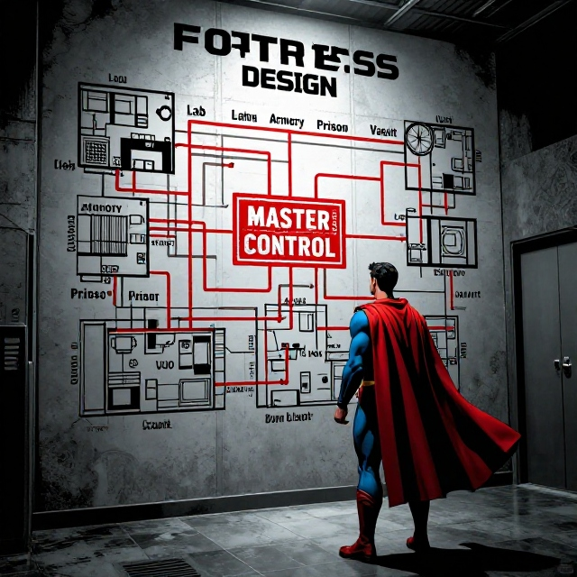

<v-click>

A06 - Insecure Design

</v-click>

<!--
Pas de cloisonnement, pas de plan B : tous les ordres critiques partent d'un seul panneau. Défaut de conception, pas de réalisation : même parfaitement codée, cette architecture ne tient pas. Il sait où aller.
-->

---

# Devant la salle maîtresse, « Je suis le boss » suffit : aucune AUTHENTIFICATION

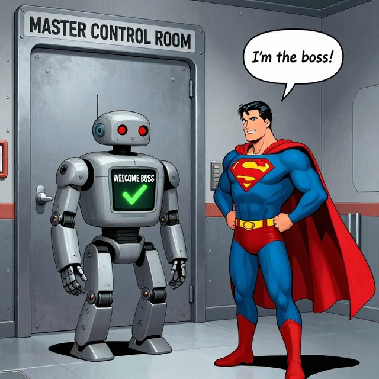

<v-click>

A07 - Authentication Failures

</v-click>

<!--
Différence avec A02 : ici le robot demande une identité mais n'en vérifie aucune (pas de 2FA).
-->

---

# Au panneau, il lance une fausse MISE À JOUR : non signée, les robots l'acceptent et envoient le canon à kryptonite dans l'espace

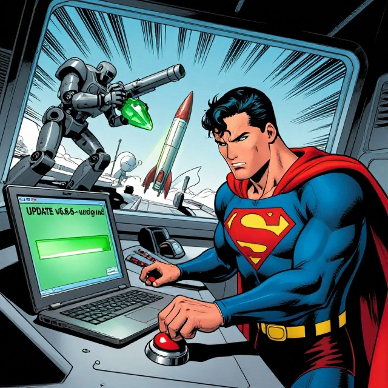

<v-click>

A08 - Software or Data Integrity Failures

</v-click>

<!--
Seul ce panneau envoie des ordres critiques et pousse des mises à jour aux robots. Ils l'installent sans vérifier la signature (INTÉGRITÉ), débranchent la kryptonite du canon et la lancent dans l'espace avec une fusée : Superman n'a jamais eu à la toucher.
-->

---

# Personne n'a rien vu : aucune ALERTE, Lex ne comprend qu'en voyant la fusée décoller

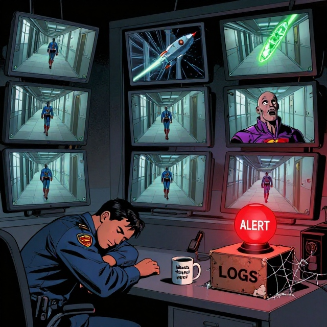

<v-click>

A09 - Logging and Alerting Failures

</v-click>

<!--
Les caméras ont tout filmé, mais personne n'a regardé les journaux.
-->

---

# Lex coupe le courant pour bloquer Superman, mais en cas de PANNE les issues de secours s'ouvrent : il s'échappe

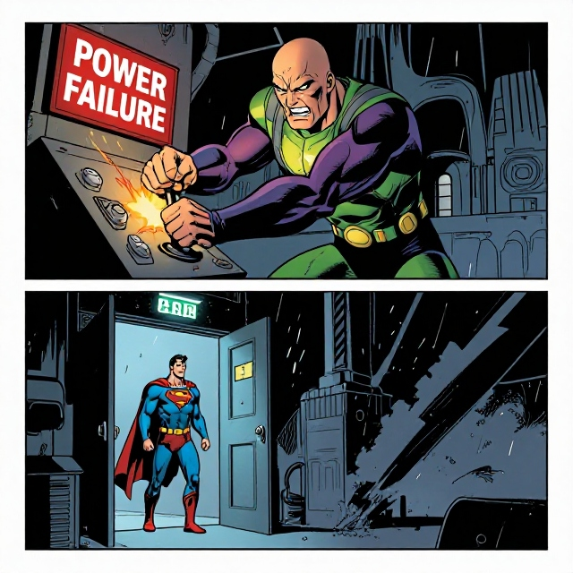

<v-click>

A10 - Mishandling of Exceptional Conditions

</v-click>

<!--
Fail-open : en cas d'erreur ou de panne, le système doit échouer de façon sûre (fail-secure).
-->

---
layout: center
class: text-center
---

# THE END

Retrouver les 10 risques dans l'ordre ?

