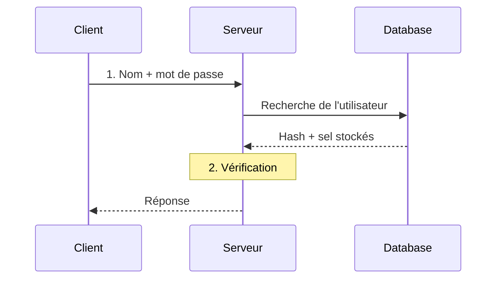

# Les sessions web

## Rester connecté sur un protocole sans mémoire

  
    ICT-183 - Thématique 03
  

---

# Les objectifs

À la fin de la séquence, vous serez capables de :

<v-clicks>

- **Expliquer** le principe d'une session
- **Connaître** les dangers liés à la gestion de mot de passe
- **Décrire** le contenu d'un token JWT
- **Valider** un token JWT à l'aide de jwt.io

</v-clicks>

<!--
Faire reformuler aux élèves la définition de ces objectifs.
-->

---

# Le principe : l'authentification

<v-click>

**Vérification** : le mot de passe salé et haché correspond-il au contenu de la base de données ?

</v-click>

<!--
Demander aux élèves ce qui se passe lors de la vérification. Poser ensuite le problème : et après ?
-->

---

# Brainstorm

Comment maintenir la connexion « ouverte » entre le client et le serveur ?

<v-click>

Et d'abord, que veut dire « ouverte » ?

</v-click>

<!--
HTTP est stateless : chaque requête est indépendante. Laisser les élèves proposer des pistes (cookie, identifiant de session, jeton...).
-->

---
layout: center
class: text-center
---

# Questions ?

Prochaine étape : la protection des mots de passe

