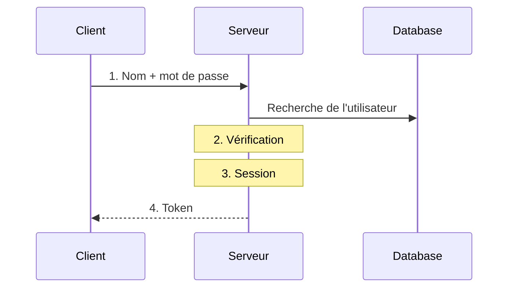
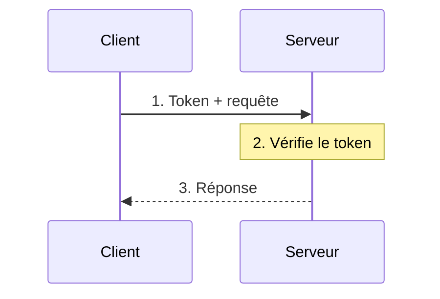
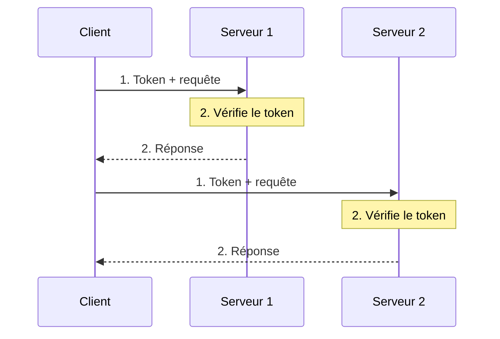

# Les jetons (tokens)

## Une session sans état côté serveur

<div class="pt-12">
  <span class="px-2 py-1 rounded bg-blue-500 text-white">
    ICT-183 - Thématique 03
  </span>
</div>

---

# Ce que l'on cherche à résoudre

<v-clicks>

- **Diminuer la complexité** au niveau serveur
- **Approcher la sécurité** de manière globale
- Le protocole HTTP est par nature **stateless**

</v-clicks>

<!--
Demander aux élèves ce que peut bien vouloir dire « stateless ». Stateless = sans état : chaque requête est indépendante des autres et le serveur n'a pas connaissance des requêtes précédentes.
-->

---

# Le principe : obtenir un token



<!--
La session n'est plus enregistrée comme un champ de la base de données.
-->

---

# Le principe : utiliser le token



---

# Les avantages

Le token se vérifie **sans base de données** : n'importe quel serveur qui connaît la clé peut le faire.



---

# Pourquoi utiliser un jeton ?

<v-clicks>

- **Réduire la charge** sur le serveur
- **Simplifier** la gestion des sessions

</v-clicks>

<v-click>

<div class="mt-4 p-3 bg-blue-700 rounded text-blue-300">

Un moyen **compact** pour transmettre de l'information en toute sécurité entre plusieurs parties.

</div>

</v-click>

---

# Contenu du jeton

<div class="grid grid-cols-3 gap-4">
<v-click>
<div class="p-3 bg-red-700 rounded text-red-100">

### Header
- Type de token (JWT)
- Algorithme de signature

</div>
</v-click>
<v-click>
<div class="p-3 bg-blue-700 rounded text-blue-300">

### Payload
Les données **en clair**

</div>
</v-click>
<v-click>
<div class="p-3 bg-green-700 rounded text-green-200">

### Signature
Permet au serveur de **vérifier** que le token est valide

</div>
</v-click>
</div>

<v-click>

```json
{ "user": "john", "iat": 1730000000, "exp": 1730003600 }
```

</v-click>

<!--
Payload : user = nom d'utilisateur connecté ; iat = Issued At (âge du jeton). Claims standardisés : iss (Issuer), exp (expiration), publics ou privés : https://www.iana.org/assignments/jwt/jwt.xhtml#claims
Problème de sécurité principal : la vérification de la signature peut être désactivée avec alg: none.
-->

---

# Attention

<div class="mt-4 p-3 bg-yellow-600 rounded text-yellow-200">

Le payload est **encodé**, pas chiffré : ne jamais y mettre de donnée secrète.

</div>

<div class="mt-4 p-3 bg-red-700 rounded text-red-100">

Rejeter les tokens avec `alg: none` : la vérification de signature ne doit jamais pouvoir être désactivée.

</div>

---
layout: center
class: text-center
---

# Activité 1

## Les jetons JWT

<div class="mt-8 text-gray-500">

Énoncé : *E-183-ALL-JWT-TOKEN.docx*

</div>
