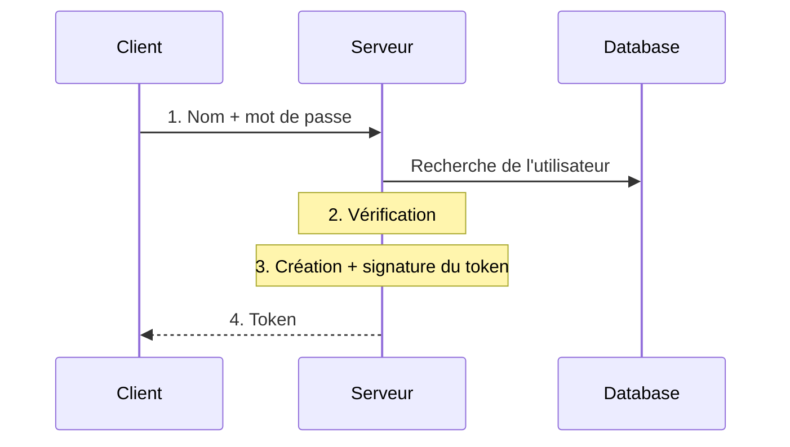
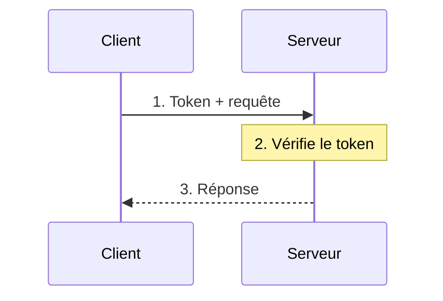
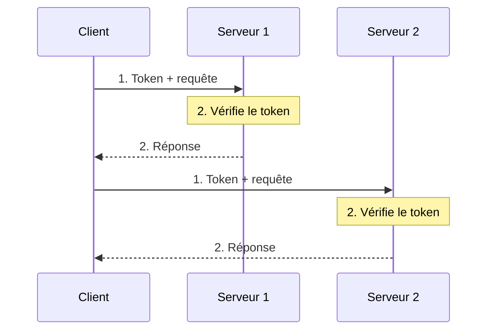

# Les jetons (tokens)

## Une session sans état côté serveur

<div class="pt-12">
  <span class="px-2 py-1 rounded bg-blue-500 text-white">
    ICT-183 - Thématique 03
  </span>
</div>

---

# Ce que l'on cherche à résoudre

<v-clicks>

- **Diminuer la complexité** au niveau serveur
- **Approcher la sécurité** de manière globale
- Le protocole HTTP est par nature **stateless**

</v-clicks>

<!--
Demander aux élèves ce que peut bien vouloir dire « stateless ». Stateless = sans état : chaque requête est indépendante des autres et le serveur n'a pas connaissance des requêtes précédentes.
-->

---

# Deux façons de « se souvenir » de l'utilisateur

<div class="grid grid-cols-2 gap-6">
<div>

### Session classique
Analogie : le **vestiaire**.

On reçoit un **numéro** (`sid=8f3a…`), le manteau reste au vestiaire.

- Le serveur **stocke** la session (mémoire / DB)
- Le cookie ne contient qu'un identifiant **opaque**
- Révocation facile : on supprime la ligne

</div>
<v-click>
<div>

### Jeton (JWT)
Analogie : le **billet de concert**.

Le billet contient **lui-même** les infos (place, date) et un **sceau** infalsifiable.

- Le serveur ne stocke **rien**
- Le jeton porte les données + une signature
- Révocation plus difficile (voir plus loin)

</div>
</v-click>
</div>

<!--
L'analogie du billet : le contrôleur ne téléphone pas à la billetterie, il vérifie le sceau (hologramme). C'est exactement ce que fait le serveur avec la signature.
-->

---

# Le principe : obtenir un token



<!--
La session n'est plus enregistrée comme un champ de la base de données.
-->

---

# Le principe : utiliser le token



---

# Les avantages

Le token se vérifie **sans base de données** : n'importe quel serveur qui connaît la clé peut le faire.



<v-click>

<div class="mt-2 p-3 bg-green-700 rounded text-green-200">

**Cas réel** : un site derrière un *load balancer* (plusieurs serveurs) ou une API appelée par une app mobile : pas besoin de partager une table de sessions.

</div>

</v-click>

---

# Pourquoi utiliser un jeton ?

<v-clicks>

- **Réduire la charge** sur le serveur
- **Simplifier** la gestion des sessions
- **Mettre à l'échelle** : ajouter des serveurs sans partager d'état

</v-clicks>

<v-click>

<div class="mt-4 p-3 bg-blue-700 rounded text-blue-300">

Un moyen **compact** pour transmettre de l'information en toute sécurité entre plusieurs parties.

</div>

</v-click>

---

# Contenu du jeton

<div class="grid grid-cols-3 gap-4">
<v-click>
<div class="p-3 bg-red-700 rounded text-red-100">

### Header
- Type de token (JWT)
- Algorithme de signature

</div>
</v-click>
<v-click>
<div class="p-3 bg-blue-700 rounded text-blue-300">

### Payload
Les données (*claims*), **encodées** en Base64URL : lisibles par tous dans un JWS, **chiffrées** seulement dans un JWE

</div>
</v-click>
<v-click>
<div class="p-3 bg-green-700 rounded text-green-200">

### Signature
Permet au serveur de **vérifier** que le token est valide

</div>
</v-click>
</div>

<v-click>

```json
{ "user": "john", "iat": 1730000000, "exp": 1730003600 }
```

</v-click>

<!--
Cette slide décrit le JWS (cas du cours, 3 parties). Un JWE a une structure différente, vue plus loin.
Payload : user = nom d'utilisateur connecté ; iat = Issued At (âge du jeton). Claims standardisés : iss (Issuer), exp (expiration), publics ou privés : https://www.iana.org/assignments/jwt/jwt.xhtml#claims
-->

---

# Un vrai jeton, décortiqué

Trois parties encodées en **Base64URL**, séparées par des points :

<div class="mt-2 p-2 rounded bg-gray-800 text-xs break-all font-mono">
<span class="text-red-400">eyJhbGciOiJIUzI1NiIsInR5cCI6IkpXVCJ9</span>.<span class="text-blue-400">eyJzdWIiOiJqb2huIiwicm9sZSI6InVzZXIiLCJpYXQiOjE3MzAwMDAwMDAsImV4cCI6MTczMDAwMzYwMH0</span>.<span class="text-green-400">W8cD91bWfkVRcsTHW1EuFmi4diZoMNG8Al2rp_dnoMI</span>
</div>

<v-click>

```bash
echo 'eyJzdWIiOiJqb2huIiwicm9sZSI6InVzZXIiLCJpYXQiOjE3MzAwMDAwMDAsImV4cCI6MTczMDAwMzYwMH0' | base64 -di
# {"sub":"john","role":"user","iat":1730000000,"exp":1730003600}
```

</v-click>

<v-click>

<div class="mt-2 p-3 bg-yellow-600 rounded text-yellow-200">

Aucune clé n'a été nécessaire pour lire le contenu : **n'importe qui** (client, proxy, malware) peut le faire. Essayer sur <https://jwt.io>.

</div>

</v-click>

<!--
Secret utilisé pour la signature de cet exemple : "secret" (HS256). Les élèves peuvent le coller dans jwt.io et vérifier la signature.
-->

---

# Les claims courants

| Claim | Signification | Exemple d'usage |
|---|---|---|
| `sub` | *Subject* : de qui parle le jeton | `"john"` ou un id d'utilisateur |
| `iss` | *Issuer* : qui a émis le jeton | `"https://auth.etml.ch"` |
| `aud` | *Audience* : à qui il est destiné | `"api-notes"` |
| `iat` | *Issued At* : date d'émission | `1730000000` |
| `exp` | *Expiration* : fin de validité | `1730003600` (1 h plus tard) |
| `role` | claim **privé** (choix de l'application) | `"admin"` |

<v-click>

<div class="mt-4 p-3 bg-blue-700 rounded text-blue-300">

`exp` est **le** garde-fou : un jeton volé n'est utilisable que jusqu'à son expiration. Toujours le **vérifier** côté serveur.

</div>

</v-click>

---

# Que se passe-t-il si on modifie le payload ?

<div class="grid grid-cols-2 gap-6">
<div>

Un attaquant remplace `"role":"user"` par `"role":"admin"` :

```json
{"sub":"john","role":"admin", ...}
```

<v-click>

La signature d'origine ne correspond plus au nouveau payload, et l'attaquant ne connaît pas la clé : il ne peut pas en calculer une nouvelle.

</v-click>

</div>
<v-click>
<div class="p-3 bg-red-700 rounded text-red-100">

### Côté serveur
1. Recalcule la signature du header + payload reçus
2. Compare avec celle du jeton
3. **Différente → 401**, la requête est rejetée

</div>
</v-click>
</div>

<!--
C'est exactement le test « Jeton modifié » de la page thématique (changer sub dans jwt.io et renvoyer).
-->

---

# Signé ≠ chiffré

<div class="grid grid-cols-2 gap-6">
<div class="p-3 bg-blue-700 rounded text-blue-300">

### JWS : *signed*
- Ce que l'on utilise dans le cours
- **Intégrité** + **authenticité**
- Contenu **lisible** par tous
- **3 parties** : `header.payload.signature`

</div>
<v-click>
<div class="p-3 bg-green-700 rounded text-green-200">

### JWE : *encrypted*
- Ajoute la **confidentialité**
- Contenu **illisible** sans la clé
- **5 parties** : `header.clé.iv.contenu.tag`

</div>
</v-click>
</div>

<v-click>

<div class="mt-4 p-3 bg-blue-800 rounded text-blue-100">

**JWT** est le concept (des *claims* en JSON). Il se transporte soit dans un **JWS**, soit dans un **JWE** (RFC 7515 / 7516 / 7519). Dans le langage courant, « JWT » désigne presque toujours un JWS.

</div>

</v-click>

---

# La structure d'un JWE (5 parties)

<div class="p-2 rounded bg-gray-800 text-xs break-all font-mono">
<span class="text-red-400">eyJlbmMiOiJBMjU2R0NNIiwiYWxnIjoiUlNBLU9BRVAifQ</span>.<span class="text-orange-400">OKOawDo13gRp2ojaHV7LFpZc…</span>.<span class="text-yellow-300">48V1_ALb6US04U3b</span>.<span class="text-blue-400">5eym8TW_c8SuK0ltJ3rpYIzOeDQz…</span>.<span class="text-green-400">XFBoMYUZodetZdvTiFvSkQ</span>
</div>

<v-clicks>

- **Header** : algorithmes (`"alg":"RSA-OAEP"`, `"enc":"A256GCM"`)
- **Clé chiffrée** : la clé de session, chiffrée avec la clé du destinataire
- **IV** : valeur aléatoire pour le chiffrement
- **Ciphertext** : le payload **chiffré**
- **Tag** : garantit l'intégrité (chiffrement authentifié)

</v-clicks>

<v-click>

<div class="mt-2 p-3 bg-blue-700 rounded text-blue-300">

Principe du **chiffrement hybride** : un chiffrement symétrique rapide (AES-GCM) pour les données, un chiffrement asymétrique (RSA) pour transmettre la clé.

</div>

</v-click>

<!--
Exemple tiré de la RFC 7516 (annexe A), abrégé. Inutile de détailler chaque champ : retenir « 5 parties, contenu illisible ».
-->

---

# Quand chiffrer ? Cas d'usage

<div class="grid grid-cols-2 gap-6">
<div class="p-3 bg-green-700 rounded text-green-200">

### JWS suffit
- Identité + rôle d'un utilisateur
- Session d'une application web
- Appel d'API entre services de confiance

→ le contenu n'est **pas secret**, seule la **fiabilité** compte.

</div>
<v-click>
<div class="p-3 bg-yellow-600 rounded text-yellow-200">

### JWE utile
- Le jeton contient une donnée **sensible** (n° AVS, e-mail, droits détaillés)
- Le jeton **transite par un tiers** (autre domaine, navigateur d'un client, app mobile)
- Exigences de **conformité** (LPD / RGPD)

</div>
</v-click>
</div>

<v-click>

<div class="mt-4 p-3 bg-blue-800 rounded text-blue-100">

**Règle** : le mieux est de **ne pas mettre** de donnée sensible dans le jeton. Le chiffrer est un plan B, il ajoute de la complexité (gestion de clés, taille, bibliothèques).

</div>

</v-click>

---

# Où stocker le jeton côté client ?

| Emplacement | Envoi automatique | Risque principal |
|---|---|---|
| Cookie `httpOnly` + `SameSite` | Oui | **CSRF** (limité par `SameSite`) ; illisible par JavaScript |
| `localStorage` | Non (entête `Authorization: Bearer`) | **XSS** : un script injecté lit le jeton |
| Mémoire JS | Non | Perdu au rechargement de la page |

<v-click>

<div class="mt-4 p-3 bg-blue-700 rounded text-blue-300">

La solution du cours utilise un cookie `httpOnly` : cf. thématique **XSS** pour comprendre pourquoi un `localStorage` est plus exposé.

</div>

</v-click>

---

# Cookie ou Bearer : qui envoie, qui lit le jeton ?

<div class="grid grid-cols-2 gap-6">
<div class="p-3 bg-blue-700 rounded text-blue-300">

### Cookie `httpOnly`
- **Envoi** : le navigateur, **automatiquement**
- **Lecture serveur** : dans le cookie
- Le JavaScript **ne peut pas** le lire

```js
getToken: req => req.cookies.authToken
// nécessite cookie-parser
```

</div>
<v-click>
<div class="p-3 bg-green-700 rounded text-green-200">

### Entête `Bearer`
- **Envoi** : le code JavaScript du client, **à la main**
- **Lecture serveur** : entête `Authorization`
- Jeton stocké en `localStorage` / mémoire

```js
fetch('/user', {
  headers: { Authorization: `Bearer ${token}` }
})
```

</div>
</v-click>
</div>

<v-click>

<div class="mt-4 p-3 bg-yellow-600 rounded text-yellow-200">

Le serveur doit **lire le jeton là où le client l'a mis**. `express-jwt` lit `Authorization: Bearer` par défaut : avec un cookie, l'option `getToken` est nécessaire. Sans elle, le serveur répond **401** malgré un jeton valide.

</div>

</v-click>

<v-click>

<div class="mt-2 p-3 bg-red-700 rounded text-red-100">

Cookie : envoyé automatiquement, donc risque **CSRF** → `SameSite=Strict`. Choisir **un seul** emplacement, pas les deux.

</div>

</v-click>

<!--
Piège classique en TP : le login renvoie bien Set-Cookie, mais le middleware cherche l'entête Authorization → 401 sur /user. Faire chercher l'erreur aux élèves.
-->

---

# Limites des jetons

<v-clicks>

- **Révocation** : un jeton signé reste valide jusqu'à `exp`, même après un logout
- **Taille** : plus gros qu'un simple identifiant de session, envoyé à chaque requête
- **Données figées** : si le rôle de l'utilisateur change, le jeton garde l'ancien jusqu'à expiration

</v-clicks>

<v-click>

<div class="mt-4 p-3 bg-green-700 rounded text-green-200">

**Bonnes pratiques** : `exp` court (5 à 15 min) + *refresh token* stocké côté serveur, et possibilité de liste de jetons révoqués (*denylist*).

</div>

</v-click>

---

# Attention

<div class="mt-4 p-3 bg-yellow-600 rounded text-yellow-200">

Le payload d'un JWS est **encodé**, pas chiffré : ne jamais y mettre de donnée secrète (sauf si JWE).

</div>

<div class="mt-4 p-3 bg-red-700 rounded text-red-100">

Rejeter les tokens avec `alg: none` : la vérification de signature ne doit jamais pouvoir être désactivée.

</div>

<v-click>

<div class="mt-4 p-3 bg-red-700 rounded text-red-100">

**Imposer l'algorithme attendu** côté serveur (`algorithms: ['HS256']`) au lieu de faire confiance au header du jeton.

</div>

</v-click>

<!--
alg:none : l'attaquant met {"alg":"none"} dans le header, retire la signature, et certaines vieilles bibliothèques acceptent le jeton sans le vérifier.
-->

---
layout: center
class: text-center
---

# Activité 1

## Les jetons JWT

<div class="mt-8 text-gray-500">

Énoncé : *E-183-ALL-JWT-TOKEN.docx*

Question bonus : un JWT peut-il être **chiffré** ? Dans quel cas ?

</div>
