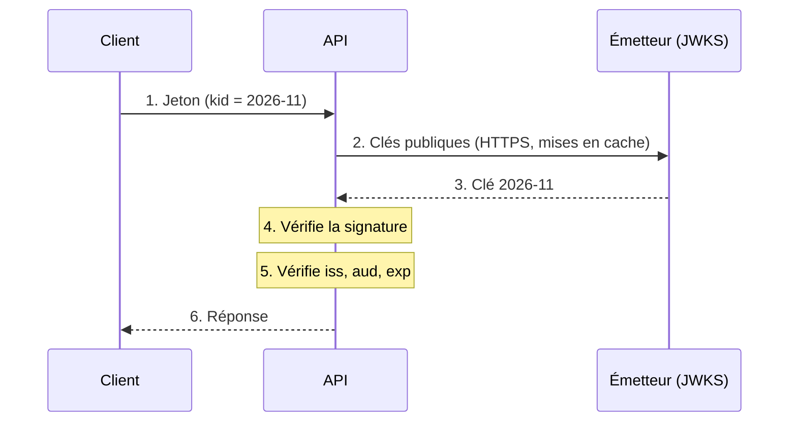

# Signature des JWT

## SHA, clés RSA, HS256 et RS256

<div class="pt-12">
  <span class="px-2 py-1 rounded bg-blue-500 text-white">
    ICT-183 - Thématique 03
  </span>
</div>

---
layout: section
---

# Partie 1
## Les SHA

---

# Définition : Secure Hash

Famille de fonctions de hachage standardisées :

<v-clicks>

- **SHA-0** et **SHA-1** : cassés, à ne plus utiliser
- **SHA-2** (SHA-256, SHA-512...) : le standard actuel, utilisé par JWT
- **SHA-3** : alternative récente

</v-clicks>

---

# Un hash en pratique

```bash
echo -n "hello" | sha256sum
# 2cf24dba5fb0a30e26e83b2ac5b9e29e1b161e5c1fa7425e73043362938b9824
echo -n "Hello" | sha256sum
# 185f8db32271fe25f561a6fc938b2e264306ec304eda518007d1764826381969
```

<v-clicks>

- Un seul caractère change → un hash **entièrement différent** (effet avalanche)
- Impossible de **retrouver** le texte depuis le hash
- Même taille (256 bits) quelle que soit l'entrée

</v-clicks>

<v-click>

<div class="mt-4 p-3 bg-blue-700 rounded text-blue-300">

Pour un JWT, on hache `header.payload` : si un octet est modifié, le hash change et la signature ne correspond plus.

</div>

</v-click>

---
layout: section
---

# Partie 2
## Générer une paire de clés (RSA)

---

# Génération de la clé privée

```bash {all|1-2|3-4}
# RSA
openssl genpkey -algorithm RSA -out server.key -pkeyopt rsa_keygen_bits:4096
# ECDSA
openssl genpkey -algorithm EC -out server.key -pkeyopt ec_paramgen_curve:P-256
```

---

# Conversion de la clé publique

```bash {all|1-2|3-4|5-6}
# PEM
openssl pkey -in server.key -pubout -out public.pem
# DER
openssl pkey -in server.key -outform DER -pubout -out public.der
# Alternative
ssh-keygen -e -m PEM -f id_rsa.pub > public.pem
```

<v-click>

<div class="mt-4 p-3 bg-blue-700 rounded text-blue-300">

Ressource utile : <https://www.cryptool.org/en/cto/openssl>

</div>

</v-click>

---
layout: section
---

# Partie 3
## RS256 vs HS256

---

# HS256

**HMAC with SHA-256**

<v-clicks>

- HMAC : *Hash-Based Message Authentication Code*
- Algorithme **symétrique**
- Une **clé unique** génère et valide la signature
- Seul le serveur émetteur du jeton est capable de prouver que le jeton n'a pas été forgé

</v-clicks>

<v-click>

```js
signature = HMAC_SHA256(base64url(header) + "." + base64url(payload), secret)
```

</v-click>

<v-click>

<div class="mt-4 p-3 bg-green-700 rounded text-green-200">

**Cas d'usage** : une application monolithique ou un seul serveur d'authentification, qui émet **et** vérifie ses propres jetons (c'est le cas de notre application).

</div>

</v-click>

<v-click>

<div class="mt-2 p-3 bg-yellow-600 rounded text-yellow-200">

**Piège** : chaque service qui doit vérifier un jeton connaît aussi le secret, donc pourrait **en forger**. Choisir un secret long et aléatoire (≥ 32 octets), jamais `secret` ou `1234`.

</div>

</v-click>

---

# RS256

**RSA Signature with SHA-256**

<v-clicks>

- Algorithme **asymétrique**
- Une **paire de clés** privée / publique
- La clé privée **signe**, la clé publique **vérifie**

</v-clicks>

<v-click>

<div class="mt-4 p-3 bg-green-700 rounded text-green-200">

La clé publique peut être donnée à tous les services qui doivent vérifier le token, sans leur permettre d'en forger.

</div>

</v-click>

<v-click>

<div class="mt-2 p-3 bg-blue-700 rounded text-blue-300">

**Cas d'usage** : « Se connecter avec Google / Microsoft ». Le fournisseur signe avec sa clé privée et publie ses clés publiques (URL **JWKS**) : des milliers de sites vérifient les jetons sans jamais pouvoir en créer. Idem pour des **microservices** : seul le service d'authentification détient la clé privée.

</div>

</v-click>

---

# Comparaison

| | HS256 | RS256 |
|---|---|---|
| Type | Symétrique | Asymétrique |
| Clés | 1 secret partagé | Privée + publique |
| Signe avec | Le secret | La clé privée |
| Vérifie avec | Le même secret | La clé publique |
| Vitesse | Très rapide | Plus lent |
| Convient pour | Une seule application | Plusieurs services / tiers |
| Si la clé fuit | Forger des jetons **et** les vérifier | Forger : seule la clé **privée** compte |

<v-click>

<div class="mt-4 p-3 bg-red-700 rounded text-red-100">

**Attaque *algorithm confusion*** : le serveur attend du RS256, l'attaquant envoie un jeton **HS256** signé avec la clé **publique** (connue de tous) comme secret. Un serveur qui se fie au header `alg` l'accepte. → toujours **imposer** l'algorithme côté serveur.

</div>

</v-click>

---

# Valider une signature : où trouver la bonne clé publique ?

La clé publique n'est pas secrète : on peut la **distribuer à tout le monde**, c'est la force de RS256. Mais encore faut-il être sûr qu'elle appartient bien à l'émetteur.

<v-clicks>

- Un attaquant qui nous remet **sa** clé publique pourrait signer des jetons que nous validerions
- Il faut donc un **lien de confiance** entre la clé et l'identité de l'émetteur

</v-clicks>

<v-click>

<div class="mt-4 p-3 bg-yellow-600 rounded text-yellow-200">

Analogie : le **sceau** d'un notaire. Chacun peut regarder l'empreinte du sceau (clé publique), mais on la compare à celle **déposée officiellement**, pas à celle présentée sur le document lui-même.

</div>

</v-click>

---

# Trois façons d'obtenir une clé de confiance

<div class="grid grid-cols-3 gap-4">
<v-click>
<div class="p-3 bg-blue-700 rounded text-blue-300">

### 1. Configurée à la main
La clé (fichier `public.pem`) est copiée dans l'application, à l'installation.

**Usage** : deux services d'une même entreprise.

</div>
</v-click>
<v-click>
<div class="p-3 bg-green-700 rounded text-green-200">

### 2. Endpoint JWKS
L'émetteur publie ses clés en JSON sur une URL **HTTPS**. Le header du jeton porte un `kid` (*key id*) qui indique laquelle.

**Usage** : Google, Microsoft, Keycloak.

</div>
</v-click>
<v-click>
<div class="p-3 bg-yellow-600 rounded text-yellow-200">

### 3. Certificat X.509
La clé publique est **signée par une autorité** (CA) qui atteste « cette clé appartient à *auth.etml.ch* ».

**Usage** : HTTPS, signature de documents.

</div>
</v-click>
</div>

<v-click>

```json
GET https://auth.example.com/.well-known/jwks.json
{ "keys": [ { "kty": "RSA", "kid": "2026-11", "alg": "RS256", "n": "0vx7agoebGcQ…", "e": "AQAB" } ] }
```

</v-click>

<!--
La confiance dans un endpoint JWKS vient de HTTPS : le certificat TLS du site prouve qu'on parle bien au bon serveur. Le header JWT peut aussi contenir x5c / x5u (chaîne de certificats) mais il ne faut jamais lui faire confiance aveuglément.
-->

---

# Les étapes de validation côté serveur



<v-click>

<div class="mt-2 p-3 bg-red-700 rounded text-red-100">

Une signature **valide** ne suffit pas : un jeton **expiré**, émis par un **autre** `iss` ou destiné à une **autre** `aud` doit être rejeté.

</div>

</v-click>

---

# Vérifier un certificat en pratique

```bash {all|1-2|3-4|5-6}
# Lire le certificat : qui est le sujet, qui l'a signé, jusqu'à quand ?
openssl x509 -in cert.pem -noout -subject -issuer -dates
# Extraire la clé publique du certificat (utilisable pour RS256)
openssl x509 -in cert.pem -pubkey -noout > public.pem
# Vérifier que le certificat est signé par la CA de confiance
openssl verify -CAfile ca.pem cert.pem
```

<v-click>

<div class="mt-4 p-3 bg-green-700 rounded text-green-200">

**Rotation** : on change régulièrement de paire de clés. Les jetons restent vérifiables car le `kid` désigne la bonne clé, et l'ancienne clé publique reste publiée jusqu'à l'expiration des jetons qu'elle a signés.

</div>

</v-click>

<v-click>

<div class="mt-2 p-3 bg-blue-700 rounded text-blue-300">

Si la clé **privée** fuit : retirer la clé publique du JWKS (ou révoquer le certificat). Tous les jetons signés avec elle deviennent invalides, c'est le prix de la sécurité.

</div>

</v-click>

---

# Et pour chiffrer ? (JWE)

La signature garantit **l'intégrité**, pas la **confidentialité**. Pour cacher le payload : JWE.

<v-clicks>

- Le chiffrement du **contenu** utilise un algo symétrique rapide : `A256GCM` (AES)
- La **clé** de ce contenu est chiffrée pour le destinataire : `RSA-OAEP` (asymétrique) ou `dir` (clé partagée)
- On peut **signer puis chiffrer** (JWS imbriqué dans un JWE) : authenticité **et** confidentialité

</v-clicks>

<v-click>

```json
{ "alg": "RSA-OAEP", "enc": "A256GCM" }
```

</v-click>

<v-click>

<div class="mt-4 p-3 bg-blue-700 rounded text-blue-300">

Les clés générées avec `openssl` à la partie 2 servent aussi au JWE : la clé **publique** chiffre, la clé **privée** déchiffre (le sens inverse de la signature).

</div>

</v-click>

<!--
Sens des clés : signature = privée signe / publique vérifie. Chiffrement = publique chiffre / privée déchiffre. Point souvent confondu, à faire énoncer par les élèves.
-->

---
layout: center
class: text-center
---

# Activité 2

## Les jetons JWT (pratique)

<div class="mt-8 text-gray-500">

Intégrer JWT dans l'application **auth** (page thématique *Sessions*, section *Implémenter dans l'application*)

</div>

---

# Par quoi commencer ?

<v-clicks>

- **Démarrer** le serveur
- **Tester** les URLs avec un client HTTP
- Dans le code : **passer en revue** les fichiers et comprendre leur fonction
- **Identifier** les fichiers à modifier

</v-clicks>

<v-click>

<div class="mt-4 p-3 bg-blue-700 rounded text-blue-300">

Sites utiles : <https://jwt.io> · <https://www.npmjs.com/package/jsonwebtoken>

</div>

</v-click>
