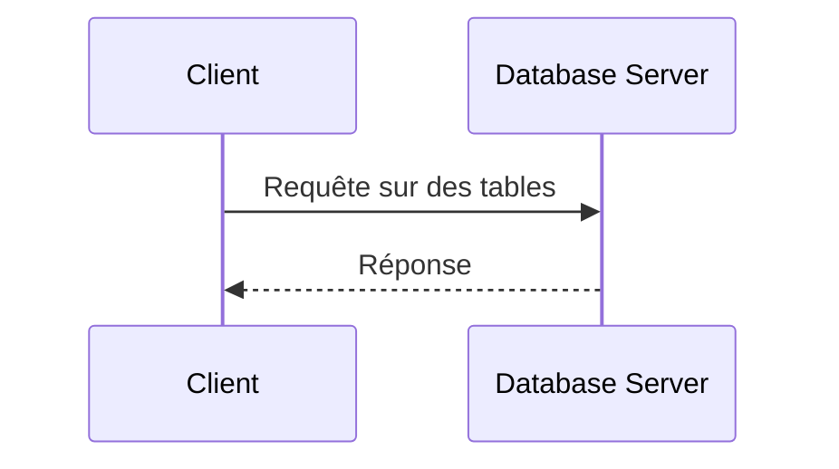
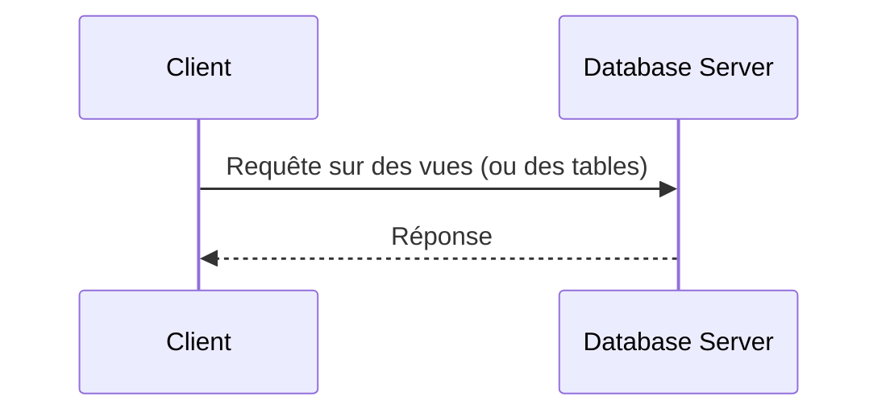

# Audit et vues MySQL

## Cloisonner l'accès aux données

<div class="pt-12">
  <span class="px-2 py-1 rounded bg-blue-500 text-white">
    ICT-183 - Thématique 05
  </span>
</div>

<!--
Brainstorm : qu'est-ce qu'un audit ? Qu'est-ce qu'on logue ?
-->

---

# Les objectifs

À la fin des activités, vous serez capables de :

<v-clicks>

- **Cloisonner** une base de données MySQL
- **Implémenter** votre mécanisme d'audit dans une base de données MySQL à l'aide de procédures stockées
- **Construire** des vues dans MySQL

</v-clicks>

<!--
Faire reformuler aux élèves la définition de chaque objectif.
-->

---

# Plan de la présentation

1. **Les vues** - principe, définition, syntaxe, modification
2. **Activité 1** - création de vues
3. **Les procédures stockées** - voir la présentation suivante

---
layout: section
---

# Partie 1
## Les vues

---

# De base…

<div class="grid grid-cols-2 gap-6">
<div>

Le client envoie sa requête **directement sur les tables**.



</div>
<v-click>
<div class="mt-8 p-3 bg-blue-800 rounded text-blue-100">

**Brainstorm** : quel est le problème rencontré ?

</div>
</v-click>
</div>

<!--
La construction de la requête est sous la responsabilité du développeur de l'application : le client voit tout le schéma.
-->

---

# Le principe

Une vue **joint et filtre** les tables, le client ne voit que le résultat.

<div class="grid grid-cols-3 gap-4 text-sm">
<div>

**t_customers**

| idCustomer | cusName | fk_country |
|---|---|---|
| 1 | John | 1 |
| 2 | Sarah | 1 |
| 3 | Louis | 3 |

</div>
<div>

**t_countries**

| idCountry | couName |
|---|---|
| 1 | Suisse |
| 2 | France |
| 3 | Italie |

</div>
<v-click>
<div>

**CREATE VIEW** →

| idCustomer | cusName | couName |
|---|---|---|
| 1 | John | Suisse |
| 2 | Sarah | Suisse |
| 3 | Louis | Italie |

</div>
</v-click>
</div>

---

# Finalement…



<v-click>

<div class="mt-4 p-3 bg-green-700 rounded text-green-200">

Un compte applicatif dédié n'a accès **qu'aux vues**, pas aux tables.

</div>

</v-click>

---

# Définition

**Représentation logique** basée sur une ou plusieurs tables.

Caractéristiques :

<v-clicks>

- **Virtuelle** : aucune donnée n'est copiée
- **Simplifiée** : masque les jointures et les colonnes inutiles
- **Sécurisée** : limite ce que voit l'utilisateur

</v-clicks>

---

# Syntaxe

Création de la vue :

```sql
CREATE VIEW <nom_de_la_vue> AS <SQL_STATEMENTS>;
```

Utilisation de la vue :

```sql
SELECT <columns> FROM <nom_de_la_vue>;
```

---

# Exemple

Vue `v_students` qui affiche le nom et le prénom des étudiants :

```sql {1-2|4}
CREATE VIEW v_students AS
SELECT stuName, stuFirstName FROM t_students;

SELECT stuName FROM v_students;
```

---

# Effacer ou modifier à partir d'une vue ?

<div class="mt-4 p-3 bg-blue-800 rounded text-blue-100">

Qu'en pensez-vous ?

</div>

<v-click>

Conditions nécessaires :

- Utilisation du moteur de base de données **InnoDB**
- La vue ne doit impliquer **qu'une seule table**

<div class="mt-4 p-3 bg-yellow-600 rounded text-yellow-200">

Plutôt une **mauvaise pratique** de faire du `INSERT`, `DELETE` ou `UPDATE` sur une vue.

</div>

</v-click>

---

# À quoi ça sert finalement ?

<div class="mt-4 p-3 bg-blue-800 rounded text-blue-100">

**Brainstorm** : citer quelques avantages à l'utilisation des vues.

</div>

---
layout: section
---

# Activité 1
## Création de vues

---

# Activité 1 : création de vues

<div class="grid grid-cols-2 gap-6">
<div>

### Ressources

- [Énoncé Views (docx)](https://etml-inf.github.io/183-SecuriteApplication/exercices/db-audit/e-183-ALL-Views.docx)
- [docker-views-stored-procedure.zip](https://etml-inf.github.io/183-SecuriteApplication/exercices/db-audit/docker-views-stored-procedure.zip)

</div>
<div>

### Forme

- Temps à disposition : **45 min**
- Travail individuel
- Auto-correction / demande individuelle

</div>
</div>

---
layout: center
class: text-center
---

# Conclusion

<v-click every=1>

Une vue **simplifie** et **protège** : le client ne voit que ce qu'il doit voir.

<div class="pt-12 mb-4">
  <span class="px-4 py-2 rounded bg-blue-500 text-white text-xl">
    Droits sur les vues, pas sur les tables
  </span>
</div>

# Questions ?

<div class="mt-8 text-gray-500">

Prochaine étape : les procédures stockées

</div>
</v-click>
