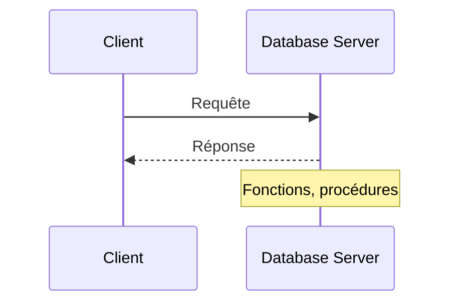
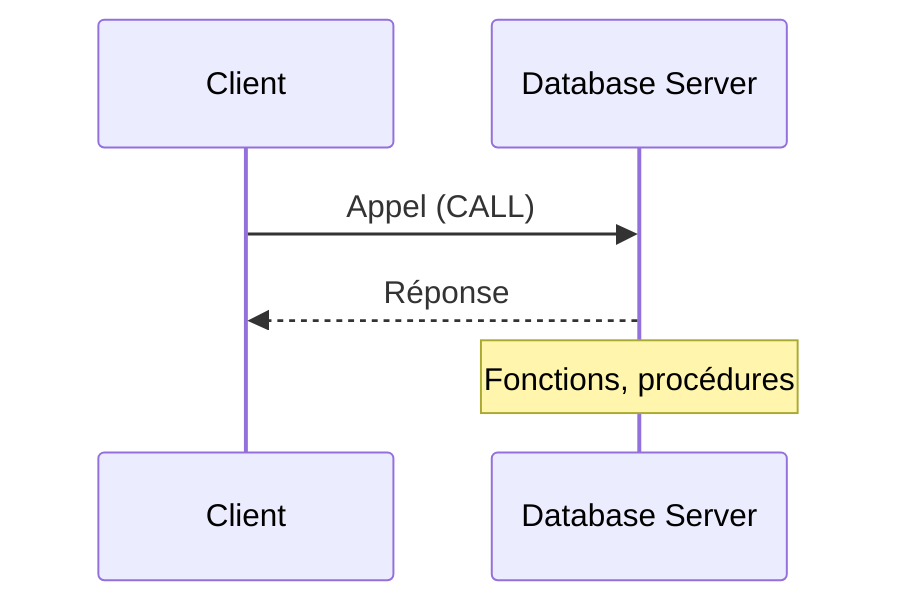

# Procédures stockées

## Stored procedures MySQL

<div class="pt-12">
  <span class="px-2 py-1 rounded bg-blue-500 text-white">
    ICT-183 - Thématique 05
  </span>
</div>

---

# Plan de la présentation

1. **Le principe** - déplacer des éléments vers le serveur
2. **La syntaxe** - `CREATE PROCEDURE`, paramètres `IN` / `OUT` / `INOUT`
3. **Un exemple** - statistiques de voitures
4. **Procédure ou fonction ?**
5. **Activité 2** - création de stored procedures

---
layout: section
---

# Partie 1
## Le principe

---

# De base…



<v-click>

# Bougeons certains éléments vers le serveur



</v-click>

---

# De quoi parle-t-on ?

Une **procédure stockée** est une série de commandes SQL **précompilées**, stockées dans la base de données.

<v-click>

<div class="mt-4 p-3 bg-green-700 rounded text-green-200">

Le client n'envoie plus de SQL : il **appelle** une procédure (`CALL`). Le serveur décide de ce qui s'exécute.

</div>

</v-click>

---

# Syntaxe

```sql
DELIMITER //
CREATE PROCEDURE <nom_de_la_procedure>([<IN argument>] [<OUT argument>])
BEGIN
   <instructions SQL>
END //
DELIMITER ;
```

<v-click>

<div class="mt-4 p-3 bg-blue-800 rounded text-blue-100">

À quoi sert le délimiteur ?

</div>

</v-click>

<!--
Réponse : le `;` termine déjà les instructions internes, il faut donc changer temporairement le délimiteur du client pour que le bloc BEGIN…END soit envoyé en entier.
-->

---

# Syntaxe : les paramètres

<v-clicks>

- **`IN`** : donner une information à la stored procedure
- **`OUT`** : récupérer une information de la stored procedure
- **`INOUT`** : donner une information **et** récupérer sa mise à jour

</v-clicks>

---

# Exemple

```sql {1-8|9-14|all}
DELIMITER //
CREATE PROCEDURE get_car_stats_by_year(
  IN year_filter int,
  OUT cars_number int,
  OUT min_value decimal(10, 2),
  OUT avg_value decimal(10, 2),
  OUT max_value decimal(10, 2)
)
BEGIN
  SELECT COUNT(*), MIN(value), AVG(value), MAX(value)
  INTO cars_number, min_value, avg_value, max_value
  FROM cars
  WHERE year = year_filter ORDER BY make, value DESC;
END //
DELIMITER ;
```

---

# Exemple : appel

```sql
CALL get_car_stats_by_year(2024, @number, @min, @average, @max);
```

---

# Procédure et fonction

<div class="grid grid-cols-2 gap-6">
<div>

### Procédure

```sql
CALL my_procedure(...);
```

- Paramètres `OUT` / `INOUT`

</div>
<div>

### Fonction

```sql
SELECT hello(name) FROM Users;
```

- Utilisable **dans** une requête
- Retourne une valeur

</div>
</div>

---
layout: section
---

# Activité 2
## Création de stored procedures

---

# Activité 2 : création de stored procedures

<div class="grid grid-cols-2 gap-6">
<div>

### Ressources

- [Énoncé Stored Procedures (docx)](https://etml-inf.github.io/183-SecuriteApplication/exercices/db-audit/e-183-ALL-StoredProcedure.docx)

</div>
<div>

### Forme

- Temps à disposition : **1-2 périodes**
- Travail individuel

</div>
</div>

---
layout: center
class: text-center
---

# Conclusion

<v-click every=1>

Une procédure stockée **centralise** la logique côté serveur.

<div class="pt-12 mb-4">
  <span class="px-4 py-2 rounded bg-blue-500 text-white text-xl">
    Le client appelle, le serveur contrôle
  </span>
</div>

# Questions ?

</v-click>
